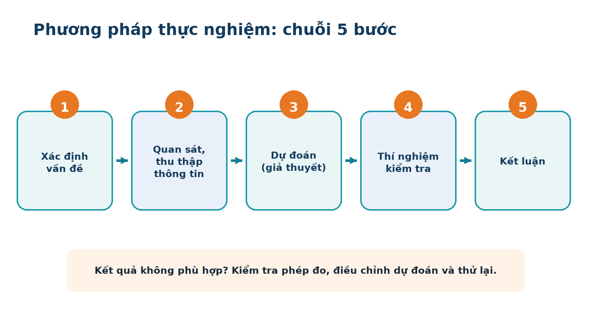
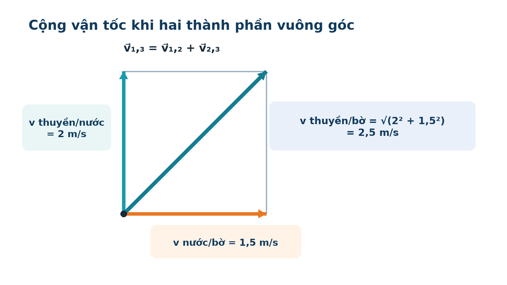
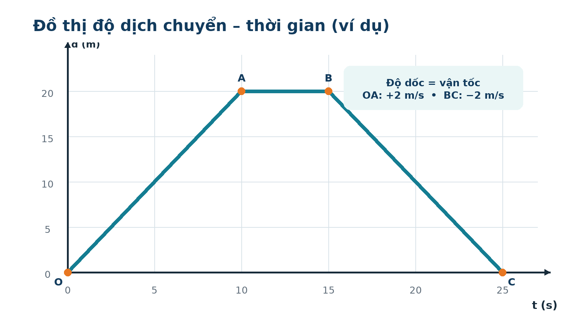
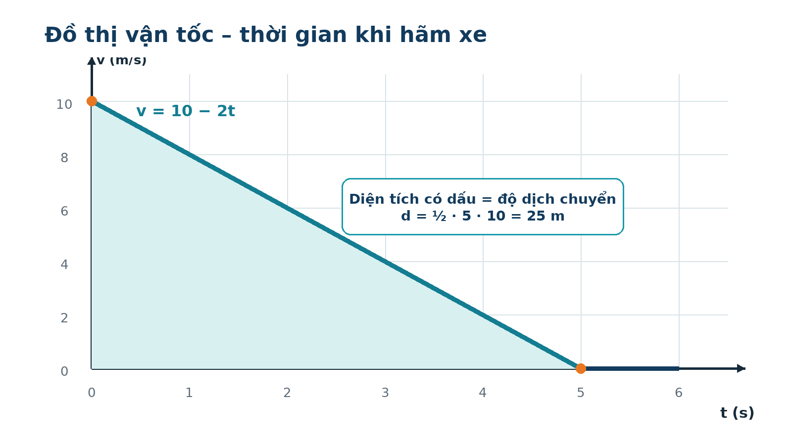

<!-- PDF title: ĐỀ CƯƠNG ÔN TẬP GIỮA KÌ I — VẬT LÍ 10 — 2026–2027 -->

# 1. ĐỊNH HƯỚNG ÔN TẬP VÀ BẢN ĐỒ MA TRẬN

> **Phạm vi nguồn — cần đọc trước:** Tệp `MA TRẬN ĐẶC TẢ KTGK I L10- 2026.docx` gồm **ma trận và bảng đặc tả**, không chứa đề thi hay đáp án soạn sẵn. Vì vậy, tài liệu này bao quát **toàn bộ yêu cầu trong tệp nguồn** và bổ sung câu hỏi luyện tập, đề minh họa cùng lời giải do tác giả biên soạn. Đây **không phải đề thi chính thức hoặc đáp án chính thức** của nhà trường.

## 1.1. Thông tin từ tệp nguồn

| Hạng mục | Nội dung |
|---|---|
| Bài kiểm tra | Giữa kì I, môn Vật lí lớp 10 |
| Năm học | 2026–2027 |
| Thời gian | 50 phút |
| Hình thức | 70% trắc nghiệm + 30% tự luận |
| Phạm vi | 10 đơn vị kiến thức/kĩ năng trong bảng đặc tả: từ “Làm quen với Vật lí” đến “Rơi tự do”, gồm cả thực hành đo tốc độ |
| Phần I | 18 câu trắc nghiệm: 10 nhận biết + 8 thông hiểu |
| Phần II | 2 câu, mỗi câu 4 ý: tổng 6 ý nhận biết + 2 ý thông hiểu |
| Phần III | 2 câu: 1 nhận biết về tốc độ–vận tốc + 1 thông hiểu về rơi tự do |
| Phần IV | Tự luận: 1 ý thông hiểu về tốc độ–vận tốc + 2 ý vận dụng về chuyển động thẳng biến đổi đều |

**Quy ước trong đề cương:** NB = nhận biết; TH = thông hiểu; VD = vận dụng; VDC = vận dụng cao. Các nhãn này giúp chọn mức luyện tập, không phải nhãn của đề thi chính thức.

## 1.2. Ma trận chi tiết — dùng để phân bổ thời gian ôn

Các ô gạch ngang nghĩa là ma trận không bố trí câu ở mức đó. “Câu I/II” ở Phần II tương ứng kí hiệu `2-I` và `2-II` trong tệp nguồn.

| Đơn vị kiến thức | I–NB | I–TH | II–NB | II–TH | III–NB | III–TH | IV–TH | IV–VD |
|---|---:|---:|---:|---:|---:|---:|---:|---:|
| 1.1. Làm quen với Vật lí | 1 | – | – | – | – | – | – | – |
| 1.2. An toàn trong phòng thực hành | 1 | 1 | – | – | – | – | – | – |
| 1.3. Sai số phép đo. Ghi kết quả đo | 1 | – | – | – | – | – | – | – |
| 2.1. Độ dịch chuyển và quãng đường | 1 | 2 | – | – | – | – | – | – |
| 2.2. Tốc độ và vận tốc | 1 | – | 2 (Câu I) | – | 1 | – | 1 | – |
| 2.3. Đồ thị độ dịch chuyển – thời gian | 1 | 1 | 2 (Câu I) | – | – | – | – | – |
| 2.4. Chuyển động biến đổi. Gia tốc | 1 | 1 | – | – | – | – | – | – |
| 2.5. Chuyển động thẳng biến đổi đều | 2 | 1 | 2 (Câu II) | 2 (Câu II) | – | – | – | 2 |
| 2.6. Sự rơi tự do | 1 | 2 | – | – | – | 1 | – | – |
| **Tổng** | **10** | **8** | **6** | **2** | **1** | **1** | **1** | **2** |

> **Ưu tiên nhưng không bỏ phần nhỏ:** Chuyển động thẳng biến đổi đều xuất hiện ở cả bốn phần và có hai ý vận dụng tự luận, nên cần luyện sâu nhất. Tuy nhiên, 10 câu nhận biết ở Phần I trải trên gần toàn bộ các bài; bỏ một bài là bỏ cơ hội ghi điểm dễ.

## 1.3. Cách dùng đề cương để nhớ lâu

1. **Vòng 1 — Hiểu:** Đọc “Kiến thức lõi”, tự viết lại công thức và nói rõ điều kiện áp dụng. Không học thuộc một công thức khi chưa biết từng kí hiệu.
2. **Vòng 2 — Gọi lại:** Che phần **Đáp** trong mỗi thẻ “Hỏi–Đáp”, trả lời thành lời hoặc ra giấy rồi mới kiểm tra. Đánh dấu lại câu sai.
3. **Vòng 3 — Vận dụng:** Làm ví dụ không nhìn lời giải; sau 24–48 giờ làm đề minh họa 50 phút. Chấm, phân loại lỗi và quay lại đúng bài tương ứng.

| Kế hoạch gợi ý | Việc cần làm | Kết quả phải có |
|---|---|---|
| Ngày 1 | Bài 1–3; lập bảng kí hiệu, an toàn và sai số | 1 trang ghi nhớ + các câu Hỏi–Đáp |
| Ngày 2 | Bài 4–6; phân biệt s/d, tốc độ/vận tốc | 5 bài tính + quy trình cổng quang điện |
| Ngày 3 | Bài 7–8; đọc đồ thị và dấu của a, v | 2 đồ thị tự vẽ + 5 bài gia tốc |
| Ngày 4 | Bài 9; ba công thức chính và bài hãm xe | 6 bài từ cơ bản đến nâng cao |
| Ngày 5 | Bài 10; rơi tự do và tổng hợp công thức | 5 bài rơi tự do + 1 phiếu công thức |
| Ngày 6 | Đề minh họa 50 phút; chữa chi tiết | Bảng lỗi theo nguyên nhân |
| Ngày 7 | Chỉ ôn câu sai, bẫy và checklist cuối | 100% mục checklist tự trả lời được |

**Bốn nguyên nhân lỗi cần tách riêng khi chữa:** không nhớ kiến thức; đọc sai dữ kiện; chọn sai công thức/dấu; tính toán hoặc đơn vị sai. Mỗi loại lỗi có cách sửa khác nhau.

<!-- PAGEBREAK -->

# 2. PHIẾU CÔNG THỨC VÀ QUY ƯỚC DẤU

## 2.1. Kí hiệu dùng xuyên suốt

| Kí hiệu | Ý nghĩa | Đơn vị SI thường dùng |
|---|---|---|
| s | Quãng đường, luôn không âm | m |
| d; Δx | Độ dịch chuyển; trong chuyển động thẳng d = x₂ − x₁ khi chọn gốc thích hợp | m |
| t; Δt | Thời điểm; khoảng thời gian | s |
| v_tb = s/Δt | Tốc độ trung bình | m/s |
| v⃗_tb = d⃗/Δt | Vận tốc trung bình | m/s, có hướng |
| v₀, v | Vận tốc ban đầu, vận tốc tại thời điểm t | m/s |
| a⃗ = Δv⃗/Δt | Gia tốc trung bình | m/s² |
| g | Gia tốc rơi tự do; gần mặt đất thường lấy 9,8 m/s² hoặc 10 m/s² theo đề | m/s² |
| ĐCNN | Độ chia nhỏ nhất của dụng cụ đo | cùng đơn vị đại lượng đo |

**Đổi đơn vị bắt buộc phải nhớ:** `1 m/s = 3,6 km/h`; đổi km/h sang m/s thì **chia 3,6**; đổi m/s sang km/h thì **nhân 3,6**. Đổi cm sang m chia 100; phút sang giây nhân 60; giờ sang giây nhân 3600.

## 2.2. Bản đồ chọn công thức

| Tình huống | Công thức chính | Điều kiện/lưu ý |
|---|---|---|
| Giá trị trung bình n lần đo | Ā = (A₁ + … + Aₙ)/n | Các Aᵢ cùng đơn vị |
| Sai số từng lần và trung bình | ΔAᵢ = \|Ā − Aᵢ\|; ΔĀ = (ΣΔAᵢ)/n | Lấy trị tuyệt đối |
| Sai số phép đo trực tiếp | ΔA = ΔĀ + ΔA_dc | Theo quy ước sai số dụng cụ của đề |
| Sai số tỉ đối | δA = (ΔA/Ā) · 100% | δ càng nhỏ, phép đo càng chính xác |
| Kết quả đo | A = Ā ± ΔA | Ā và ΔA cùng bậc thập phân |
| Tổng/hiệu hai đại lượng | ΔA = ΔB + ΔC | Cộng **sai số tuyệt đối** |
| Tích/thương hai đại lượng | δA = δB + δC | Cộng **sai số tỉ đối** |
| Tốc độ trung bình | v_tb = tổng quãng đường/tổng thời gian | Không mặc định lấy trung bình cộng các tốc độ |
| Vận tốc trung bình | v⃗_tb = độ dịch chuyển/tổng thời gian | Có thể bằng 0 dù vật đã đi quãng đường dài |
| Cộng vận tốc | v⃗₁,₃ = v⃗₁,₂ + v⃗₂,₃ | Cộng vectơ; xét chiều khi cùng phương |
| Độ dốc đồ thị d–t | v = Δd/Δt | Dốc lên: v > 0; ngang: v = 0; dốc xuống: v < 0 |
| Gia tốc | a⃗ = (v⃗ − v⃗₀)/Δt | Đặc trưng cho biến thiên vận tốc |
| Chuyển động thẳng biến đổi đều | v = v₀ + at | a không đổi; chọn chiều dương trước |
| Độ dịch chuyển | d = v₀t + ½at² | Nếu đổi chiều, không được đồng nhất độ lớn của d với s |
| Liên hệ không chứa t | v² − v₀² = 2ad | Dùng d có dấu trong chuyển động thẳng |
| Vận tốc trung bình khi a không đổi | v_tb,d = (v₀ + v)/2 | Chỉ trong cùng một giai đoạn a không đổi |
| Rơi tự do từ trạng thái nghỉ | v = gt; h = ½gt²; v² = 2gh | “Thả nhẹ” ⇒ v₀ = 0; bỏ qua sức cản |
| Thời gian rơi từ độ cao h | t = √(2h/g) | h là quãng đường rơi |
| Quãng đường trong giây thứ n | sₙ = s(n) − s(n − 1) | Với rơi từ nghỉ: sₙ = ½g(2n − 1) |

> **Chốt nhớ bằng một câu:** **Đường** thì cộng toàn bộ; **dịch chuyển** chỉ nhìn đầu–cuối; **dốc d–t** là vận tốc; **dốc v–t** là gia tốc; **diện tích v–t có dấu** là độ dịch chuyển.

## 2.3. Quy tắc dấu trong chuyển động thẳng

- Chọn chiều dương trước khi thay số. Vectơ cùng chiều dương có giá trị dương; ngược chiều dương có giá trị âm.
- `a > 0` **không đồng nghĩa** nhanh dần; `a < 0` **không đồng nghĩa** chậm dần.
- Nhanh dần khi `a·v > 0` (a và v cùng dấu); chậm dần khi `a·v < 0` (a và v trái dấu).
- Nếu vật dừng rồi đảo chiều, phải chia bài toán thành các giai đoạn để tính quãng đường.

| v | a | a·v | Tốc độ đang |
|---:|---:|---:|---|
| + | + | + | Tăng: nhanh dần theo chiều dương |
| + | − | − | Giảm: chậm dần theo chiều dương |
| − | − | + | Tăng: nhanh dần theo chiều âm |
| − | + | − | Giảm: chậm dần khi đi theo chiều âm |

<!-- PAGEBREAK -->

# 3. BÀI 1 — LÀM QUEN VỚI VẬT LÍ

## 3.1. Yêu cầu trong đặc tả

- NB: đối tượng nghiên cứu; thành tựu Vật lí gắn với các cuộc cách mạng công nghiệp; quá trình phát triển; phương pháp nghiên cứu.
- TH: giải thích và sắp xếp quá trình nghiên cứu Vật lí.

## 3.2. Kiến thức lõi

**Đối tượng nghiên cứu.** Vật lí là khoa học tự nhiên nghiên cứu các dạng vận động của vật chất (chất và trường) cùng năng lượng. Các lĩnh vực tiêu biểu: cơ học, nhiệt học–nhiệt động lực học, điện–điện từ, quang học, âm học, vật lí nguyên tử–hạt nhân, vật lí lượng tử và thuyết tương đối.

**Quá trình phát triển — nhớ theo mạch “quan sát → định lượng → thống nhất → hiện đại”.**

| Giai đoạn | Dấu mốc tiêu biểu | Ý nghĩa |
|---|---|---|
| Quan sát ban đầu | Nhận xét hiện tượng tự nhiên; nhiều giải thích còn dựa vào suy luận định tính | Hình thành câu hỏi khoa học |
| Cơ học cổ điển | Galileo gắn thí nghiệm với toán học; Newton xây dựng hệ định luật cơ học và hấp dẫn | Phương pháp thực nghiệm–định lượng phát triển mạnh |
| Thế kỉ XVIII–XIX | Nhiệt động lực học, điện từ học | Nền tảng máy hơi nước, máy phát điện và công nghệ điện |
| Cuối XIX–XX | Thuyết tương đối, vật lí lượng tử; hiểu sâu cấu trúc vật chất | Mở ra Vật lí hiện đại |
| Hiện nay | Điện tử, bán dẫn, vi mạch, laser, vật liệu nano, tính toán khoa học | Tự động hóa, truyền thông, thiết bị thông minh và công nghệ mới |

**Vật lí và bốn cuộc cách mạng công nghiệp.**

| Cuộc cách mạng | Nền tảng Vật lí nổi bật | Đặc trưng cần nhớ |
|---|---|---|
| Lần thứ nhất | Nghiên cứu nhiệt, nhiệt động lực học; máy hơi nước | Cơ khí hóa, máy móc thay sức cơ bắp |
| Lần thứ hai | Điện từ học, cảm ứng điện từ, máy phát điện | Sử dụng rộng rãi điện năng |
| Lần thứ ba | Điện tử, chất bán dẫn, vi mạch | Tự động hóa sản xuất |
| Lần thứ tư | Ứng dụng tổng hợp Vật lí hiện đại và công nghệ số | AI, robot, Internet, nano, thiết bị thông minh |

> **Mẹo nhớ 4 cuộc:** **Hơi – Điện – Tự động – Thông minh.** Không đổi chỗ cảm ứng điện từ (lần II) với bán dẫn–vi mạch (lần III).

**Hai phương pháp nghiên cứu thường dùng.**

- **Phương pháp thực nghiệm:** xác định vấn đề → quan sát, thu thập thông tin → đưa ra dự đoán → thí nghiệm kiểm tra → kết luận. Nếu kết quả không phù hợp, phải kiểm tra phép đo, giả thuyết và điều kiện thí nghiệm.
- **Phương pháp mô hình:** chọn các đặc điểm bản chất, lí tưởng hóa đối tượng, xây dựng mô hình rồi dùng mô hình để giải thích/dự đoán. Ba dạng quen thuộc: **mô hình vật chất** (quả địa cầu), **mô hình lí thuyết** (chất điểm, tia sáng), **mô hình toán học** (công thức, phương trình, đồ thị).

*Hình 3.1. Thực nghiệm là một vòng kiểm chứng; kết luận phải dựa trên bằng chứng.*

## 3.3. Hỏi–Đáp ghi nhớ

> **Hỏi 1.1 (NB):** Đối tượng nghiên cứu chủ yếu của Vật lí là gì?
>
> **Đáp:** Các dạng vận động của vật chất (chất, trường) và năng lượng. Có thể dẫn chứng bằng chuyển động cơ, điện từ, nhiệt, quang, hạt nhân…

> **Hỏi 1.2 (NB):** Nêu bốn cặp “thành tựu – cách mạng công nghiệp” dễ ra trắc nghiệm.
>
> **Đáp:** Nhiệt/máy hơi nước – lần I; cảm ứng điện từ/máy phát điện – lần II; điện tử, bán dẫn, vi mạch – lần III; công nghệ số, AI, robot, Internet, nano – lần IV.

> **Hỏi 1.3 (NB):** Vì sao nói Vật lí là cơ sở của khoa học tự nhiên và công nghệ?
>
> **Đáp:** Các khái niệm, định luật Vật lí giải thích hiện tượng từ vi mô đến vĩ mô và làm nền tảng cho thiết bị, kĩ thuật. Tuy nhiên, ứng dụng phải có trách nhiệm vì công nghệ cũng có thể gây tác động môi trường.

> **Hỏi 1.4 (NB):** Phương pháp thực nghiệm gồm năm bước theo trình tự nào?
>
> **Đáp:** Xác định vấn đề → quan sát, thu thập thông tin → dự đoán → thí nghiệm kiểm tra → kết luận. Không được bỏ bước kiểm tra để biến dự đoán thành kết luận.

> **Hỏi 1.5 (NB):** Phân biệt ba loại mô hình bằng ví dụ.
>
> **Đáp:** Quả địa cầu là mô hình vật chất; coi vật là chất điểm là mô hình lí thuyết; `d = v₀t + ½at²` là mô hình toán học.

> **Hỏi 1.6 (TH):** Một bạn cho rằng “vật nặng luôn rơi nhanh hơn vật nhẹ”. Hãy đề xuất cách nghiên cứu theo phương pháp thực nghiệm.
>
> **Đáp:** Xác định cần kiểm tra ảnh hưởng của khối lượng; quan sát và thu tài liệu; dự đoán về thời gian rơi; thả các vật trong cùng điều kiện, kiểm soát hình dạng và sức cản, đo nhiều lần; so sánh số liệu rồi kết luận trong phạm vi thí nghiệm.

> **Hỏi 1.7 (TH):** Khi thí nghiệm không ủng hộ dự đoán, có được thay số liệu để “cho đúng” không?
>
> **Đáp:** Không. Phải kiểm tra dụng cụ, thao tác, điều kiện thí nghiệm và giả thuyết; đo lại khách quan. Số liệu không phù hợp vẫn là bằng chứng khoa học cần giải thích.

> **Hỏi 1.8 (TH):** Vì sao mô hình chất điểm hữu ích dù vật thật luôn có kích thước?
>
> **Đáp:** Khi kích thước vật không ảnh hưởng đáng kể tới vấn đề, bỏ qua nó giúp đơn giản hóa và tìm quy luật chính. Mô hình có phạm vi sử dụng; nếu cần xét quay hoặc biến dạng thì mô hình đó không còn đủ.

<!-- PAGEBREAK -->

# 4. BÀI 2 — CÁC QUY TẮC AN TOÀN TRONG PHÒNG THỰC HÀNH VẬT LÍ

## 4.1. Yêu cầu trong đặc tả

- NB: nguy cơ mất an toàn khi dùng thiết bị; quy tắc an toàn trong phòng thực hành.
- TH: hiểu và sử dụng thiết bị thí nghiệm; hiểu và sử dụng biển báo.

## 4.2. Nhận diện nguy cơ và cách phòng tránh

| Nhóm thiết bị/tình huống | Nguy cơ | Cách sử dụng an toàn |
|---|---|---|
| Nguồn điện, dây dẫn, thiết bị đo | Điện giật, chập–cháy, hỏng thiết bị, quá tải | Đọc thông số; kiểm tra dây; ngắt nguồn trước khi cắm/tháo; đúng điện áp, cực, thang đo; tay và sàn khô |
| Thủy tinh và thiết bị nhiệt | Nứt vỡ, cắt tay, bỏng, cháy do đèn cồn | Kiểm tra vết nứt; dùng kẹp/găng bảo hộ; không chạm vật nóng; không đổ chất lạnh vào dụng cụ đang nóng; dập đèn đúng cách |
| Nguồn laser, thiết bị quang | Tổn thương mắt; xước/mốc/bẩn bề mặt quang | Không nhìn trực tiếp hoặc chiếu laser vào người; giữ khoảng cách; cầm đúng vị trí, dùng dụng cụ làm sạch phù hợp |
| Vật bắn, vật nặng, giá đỡ | Đập vào người, đổ giá, vật văng | Cố định giá; đứng ngoài vùng nguy hiểm; dùng tấm chắn/bảo hộ khi cần |
| Hóa chất, chất dễ cháy, chất thải | Ngộ độc, kích ứng, cháy nổ, thải sai nơi quy định | Đọc nhãn; tránh tiếp xúc; xa nguồn điện/lửa; dùng bảo hộ; thu gom đúng nơi |

**Đọc thiết bị trước khi dùng.** Nhận diện điện áp đầu vào/ra, giới hạn đo, cực `+`/`−`, kí hiệu `AC` (xoay chiều), `DC` (một chiều), nút nguồn, nút chọn chức năng và cảnh báo. Chỉ cấp nguồn phù hợp với định mức. Với bộ nguồn có nút điều chỉnh, bắt đầu ở mức thấp theo hướng dẫn rồi tăng dần khi cần.

**Đọc biển báo đúng.** Các biển thường gặp cảnh báo điện cao thế, vật nóng, laser, chất dễ cháy/nổ/độc/ăn mòn, yêu cầu bảo hộ hoặc cấm bỏ vào thùng rác. Phải đọc cả hình và chữ trên biển; không suy đoán chỉ từ màu sắc. Biển báo giúp nhận biết nguy cơ và chọn hành động phòng tránh, không thay thế hướng dẫn của giáo viên.

## 4.3. Mười quy tắc phải thuộc bằng hành động

1. Đọc kĩ hướng dẫn, quan sát chỉ dẫn, kí hiệu và thông số trên thiết bị.
2. Kiểm tra thiết bị, phương tiện, dụng cụ trước khi sử dụng.
3. Chỉ thí nghiệm khi được giáo viên cho phép/hướng dẫn.
4. Tắt công tắc nguồn trước khi cắm hoặc tháo thiết bị điện.
5. Chỉ nối nguồn khi điện áp phù hợp định mức; chọn đúng chức năng/thang đo.
6. Bố trí dây điện gọn, không vướng lối đi; rút phích bằng cách cầm phích, không giật dây.
7. Không tiếp xúc trực tiếp với vật nóng khi thiếu dụng cụ bảo hộ.
8. Không để nước, vật/dung dịch dẫn điện hoặc chất dễ cháy gần thiết bị điện.
9. Giữ khoảng cách an toàn với vật nung nóng, vật có thể bắn ra và tia laser.
10. Sau thí nghiệm: ngắt nguồn, vệ sinh, sắp xếp thiết bị, bỏ chất thải đúng nơi quy định.

> **Chuỗi nhớ an toàn:** **Đọc – Kiểm – Được phép – Ngắt – Đúng – Gọn – Bảo hộ – Tránh – Khoảng cách – Dọn.** Nếu có sự cố điện/cháy, ưu tiên báo giáo viên và ngắt nguồn khi an toàn; không tự xử lí mạo hiểm.

## 4.4. Hỏi–Đáp tình huống

> **Hỏi 2.1 (NB):** Nêu năm nhóm nguy cơ tiêu biểu trong phòng thực hành.
>
> **Đáp:** Điện giật/chập cháy; bỏng và vỡ thủy tinh; tổn thương mắt do laser; vật bắn/đổ giá; hóa chất, cháy nổ và chất thải nguy hại.

> **Hỏi 2.2 (NB):** Trước khi cắm hoặc tháo thiết bị điện phải làm gì?
>
> **Đáp:** Tắt công tắc nguồn. Khi rút, cầm thân phích; không giật dây vì có thể làm hở mạch, đứt dây và gây điện giật.

> **Hỏi 2.3 (TH):** Một bóng đèn thí nghiệm ghi 6 V DC nhưng bạn định cắm vào đầu ra 12 V AC. Được hay không?
>
> **Đáp:** Không. Sai cả mức điện áp và loại dòng theo nhãn thiết bị; có thể hỏng đèn, quá nhiệt hoặc gây nguy hiểm. Phải chọn nguồn 6 V DC phù hợp.

> **Hỏi 2.4 (TH):** Vì sao không được nhìn trực tiếp vào tia laser dù chùm sáng rất nhỏ?
>
> **Đáp:** Năng lượng tập trung có thể làm tổn thương mắt. Không chiếu vào mắt người, không ngắm trực tiếp nguồn hoặc chùm phản xạ nguy hiểm; giữ khoảng cách và tuân thủ biển cảnh báo.

> **Hỏi 2.5 (TH):** Cốc thủy tinh có vết nứt nhỏ nhưng vẫn đựng được nước, có nên dùng để đun?
>
> **Đáp:** Không. Khi nung, vết nứt có thể lan nhanh làm cốc vỡ, gây bỏng/cắt tay và cháy. Báo giáo viên và thay dụng cụ đạt yêu cầu.

> **Hỏi 2.6 (TH):** Nước đổ gần ổ điện, bạn nên xử lí thế nào?
>
> **Đáp:** Không chạm vào thiết bị/ổ điện khi còn nguy cơ; báo giáo viên, giữ người khác ra xa và chỉ ngắt nguồn nếu có thể thực hiện an toàn. Lau dọn sau khi đã loại bỏ nguy cơ điện.

> **Hỏi 2.7 (TH):** Vì sao dây điện phải bố trí gọn và thiết bị cần được dọn sau thí nghiệm?
>
> **Đáp:** Tránh vấp ngã, kéo đổ thiết bị, hỏng dây và tai nạn cho người khác; bảo quản thiết bị và giữ môi trường thực hành an toàn.

> **Hỏi 2.8 (TH):** Một biển có hình tia sét trong tam giác cảnh báo điều gì và hành động phù hợp là gì?
>
> **Đáp:** Thường cảnh báo nguy cơ điện nguy hiểm/cao thế. Không chạm hoặc mở thiết bị khi chưa có hướng dẫn; kiểm tra nguồn, dây, thông số và thực hiện quy tắc an toàn điện.

<!-- PAGEBREAK -->

# 5. BÀI 3 — THỰC HÀNH TÍNH SAI SỐ TRONG PHÉP ĐO. GHI KẾT QUẢ ĐO

## 5.1. Yêu cầu trong đặc tả

- NB: phép đo trực tiếp/gián tiếp; các loại sai số; nguyên nhân; công thức giá trị trung bình, sai số tuyệt đối và tỉ đối.
- TH: ghi đúng kết quả và sai số; tính sai số tuyệt đối, tỉ đối.
- VD: tính giá trị đo và sai số trong tình huống cụ thể.

## 5.2. Phép đo và các loại sai số

| Khái niệm | Cách nhận biết | Ví dụ |
|---|---|---|
| Đo trực tiếp | Đọc đại lượng cần đo ngay từ dụng cụ | Đo chiều dài bằng thước, thời gian bằng đồng hồ |
| Đo gián tiếp | Tính đại lượng cần đo qua công thức từ các phép đo khác | Đo s, t rồi tính v = s/t |
| Sai số hệ thống | Lặp lại gần như cùng chiều/cùng dạng; thường do dụng cụ lệch chuẩn, điểm 0, quy trình | Thước bị mòn đầu 0 làm các lần đo đều lệch |
| Sai số ngẫu nhiên | Thay đổi không theo quy luật giữa các lần đo | Phản xạ bấm giây, đọc vạch, điều kiện thí nghiệm dao động nhỏ |
| Sai số dụng cụ | Do giới hạn phân giải/độ chính xác của dụng cụ | Thước có ĐCNN 0,1 cm |

**Giảm sai số đúng cách:** hiệu chỉnh và chọn dụng cụ phù hợp để hạn chế sai số hệ thống; thao tác chuẩn, đo nhiều lần và lấy trung bình để giảm ảnh hưởng sai số ngẫu nhiên. Không thể khẳng định “đo nhiều lần sẽ loại bỏ mọi sai số”.

## 5.3. Công thức bắt buộc

Với n lần đo đại lượng A:

- **Giá trị trung bình:** `Ā = (A₁ + A₂ + … + Aₙ)/n`.
- **Sai số ngẫu nhiên tuyệt đối của lần i:** `ΔAᵢ = |Ā − Aᵢ|`.
- **Sai số ngẫu nhiên tuyệt đối trung bình:** `ΔĀ = (ΔA₁ + … + ΔAₙ)/n`.
- **Sai số tuyệt đối của phép đo:** `ΔA = ΔĀ + ΔA_dc`.
- **Sai số tỉ đối:** `δA = (ΔA/Ā) · 100%`.
- **Ghi kết quả:** `A = Ā ± ΔA`, tương đương `Ā − ΔA ≤ A ≤ Ā + ΔA`.

Trong bài THPT, nếu đề không cho quy ước riêng, sai số dụng cụ thường được lấy theo hướng dẫn của dụng cụ/SGK; nhiều bài dùng **nửa ĐCNN**. Phải đọc đề để biết dùng nửa hay một ĐCNN, không áp dụng máy móc cho mọi dụng cụ.

**Quy tắc ghi và làm tròn:** ΔA và Ā phải cùng đơn vị; Ā được ghi tới bậc thập phân tương ứng với ΔA. Khi bỏ chữ số: nhỏ hơn 5 thì giữ nguyên chữ số bên trái; từ 5 trở lên thì tăng chữ số bên trái một đơn vị. Sai số tỉ đối càng nhỏ thì phép đo càng chính xác.

## 5.4. Sai số phép đo gián tiếp

| Dạng công thức | Quy tắc | Ví dụ |
|---|---|---|
| A = B + C hoặc A = B − C | ΔA = ΔB + ΔC | Tổng/hiệu: cộng sai số **tuyệt đối** |
| A = B·C hoặc A = B/C | δA = δB + δC | Tích/thương: cộng sai số **tỉ đối** |
| Biết δA và Ā | ΔA = (δA/100%) · Ā | Đổi phần trăm về tỉ số trước khi nhân |

> **Bẫy thường gặp:** Với phép **trừ**, sai số tuyệt đối vẫn **cộng**; với phép **chia**, sai số tỉ đối vẫn **cộng**. Không được trừ sai số theo dấu của công thức đại lượng.

## 5.5. Ví dụ trực tiếp — làm đủ năm bước

Đo chiều dài năm lần: `12,4; 12,5; 12,3; 12,4; 12,4 cm`. Dụng cụ có `ΔA_dc = 0,05 cm`.

1. **Trung bình:** `Ā = (12,4 + 12,5 + 12,3 + 12,4 + 12,4)/5 = 12,4 cm`.
2. **Sai số từng lần:** lần lượt `0; 0,1; 0,1; 0; 0 cm`, nên `ΔĀ = 0,2/5 = 0,04 cm`.
3. **Sai số tuyệt đối:** `ΔA = 0,04 + 0,05 = 0,09 cm`.
4. **Sai số tỉ đối:** `δA = 0,09/12,4 · 100% ≈ 0,73%`.
5. **Kết quả:** `A = 12,40 ± 0,09 cm` (ghi trung bình tới hai chữ số thập phân để phù hợp với sai số).

## 5.6. Ví dụ gián tiếp — tốc độ

Cho `s = 1,200 ± 0,006 m` và `t = 2,00 ± 0,02 s`.

- `s̄/t̄ = 1,200/2,00 = 0,600 m/s`.
- `δs = 0,006/1,200 · 100% = 0,5%`; `δt = 0,02/2,00 · 100% = 1,0%`.
- Vì `v = s/t`: `δv = 0,5% + 1,0% = 1,5%`.
- `Δv = 1,5% · 0,600 = 0,009 m/s`.
- **Kết quả:** `v = 0,600 ± 0,009 m/s`.

## 5.7. Hỏi–Đáp ghi nhớ

> **Hỏi 3.1 (NB):** Đo tốc độ bằng cách đo quãng đường và thời gian rồi tính s/t là phép đo gì?
>
> **Đáp:** Tốc độ được xác định bằng phép đo **gián tiếp**; phép đo s và t riêng lẻ là phép đo trực tiếp.

> **Hỏi 3.2 (NB):** Vì sao các lần đo cùng một đại lượng vẫn có thể khác nhau?
>
> **Đáp:** Do giới hạn dụng cụ, thao tác/đọc số, phản xạ người đo và điều kiện thí nghiệm không hoàn toàn ổn định. Cần phân biệt nguyên nhân hệ thống với ngẫu nhiên.

> **Hỏi 3.3 (NB):** Viết bốn công thức lõi của phép đo trực tiếp.
>
> **Đáp:** `Ā = ΣAᵢ/n`; `ΔAᵢ = |Ā − Aᵢ|`; `ΔA = ΔĀ + ΔA_dc`; `δA = ΔA/Ā · 100%`.

> **Hỏi 3.4 (TH):** Hai phép đo có cùng ΔA = 0,1 cm nhưng Ā lần lượt 5 cm và 50 cm. Phép nào chính xác hơn theo sai số tỉ đối?
>
> **Đáp:** Phép đo 50 cm vì δ lần lượt là 2% và 0,2%; sai số tỉ đối nhỏ hơn nên mức độ chính xác tương đối cao hơn.

> **Hỏi 3.5 (TH):** Ba lần đo cho 4,0; 4,2; 3,8 s. Tính Ā và ΔĀ nếu chưa cộng sai số dụng cụ.
>
> **Đáp:** `Ā = 4,0 s`; độ lệch tuyệt đối `0; 0,2; 0,2 s`; `ΔĀ = 0,4/3 ≈ 0,133 s`.

> **Hỏi 3.6 (TH):** Kết quả `A = 12,345 ± 0,01 cm` đã phù hợp quy tắc bậc thập phân chưa? Sửa thế nào?
>
> **Đáp:** Chưa; trung bình có ba chữ số thập phân, sai số có hai. Làm tròn trung bình thành `12,35`, kết quả `12,35 ± 0,01 cm`.

> **Hỏi 3.7 (TH):** Có được viết sai số tỉ đối là 0,02 cm không?
>
> **Đáp:** Không. Sai số tỉ đối thường biểu diễn bằng phần trăm và không có đơn vị cm; 0,02 cm là sai số tuyệt đối.

> **Hỏi 3.8 (VD):** Cho A = B − C với ΔB = 0,03 m và ΔC = 0,02 m. Tính ΔA.
>
> **Đáp:** `ΔA = ΔB + ΔC = 0,05 m`, không phải 0,01 m.

> **Hỏi 3.9 (VD):** Một phép đo có δA = 2% và Ā = 50 cm. Tính ΔA.
>
> **Đáp:** `ΔA = 0,02 · 50 = 1 cm`.

> **Hỏi 3.10 (VD):** Vì sao không nên làm tròn quá sớm từng giá trị trung gian?
>
> **Đáp:** Làm tròn sớm có thể cộng dồn sai số tính toán. Nên giữ đủ chữ số trong các bước và chỉ làm tròn kết quả theo quy tắc ghi phép đo.

<!-- PAGEBREAK -->

# 6. BÀI 4 — ĐỘ DỊCH CHUYỂN VÀ QUÃNG ĐƯỜNG ĐI ĐƯỢC

## 6.1. Yêu cầu trong đặc tả

- NB: định nghĩa độ dịch chuyển; so sánh với quãng đường.
- TH: xác định độ dịch chuyển và quãng đường.
- VD/VDC: tính hai đại lượng trong bài toán một chiều, đổi chiều và nhiều chặng.

## 6.2. Hai đại lượng phải tách rõ

| Tiêu chí | Quãng đường s | Độ dịch chuyển d⃗ |
|---|---|---|
| Bản chất | Độ dài toàn bộ quỹ đạo đã đi | Vectơ nối từ vị trí đầu tới vị trí cuối |
| Loại đại lượng | Vô hướng, không âm | Vectơ, có độ lớn và hướng |
| Phụ thuộc | Cả đường đi | Chỉ vị trí đầu–cuối và hệ quy chiếu |
| Khi đi kín một vòng | s > 0 | d⃗ = 0⃗ |
| Quan hệ | `s ≥ \|d\|` | `\|d\| ≤ s` |

Trong chuyển động thẳng trên trục Ox: `d = x₂ − x₁`. Dấu cho biết chiều; độ lớn là `\|d\|`. Khi vật đi thẳng **và không đổi chiều**, `s = \|d\|`.

**Cộng độ dịch chuyển nhiều chặng:** `d⃗ = d⃗₁ + d⃗₂ + …` (cộng vectơ), còn quãng đường luôn `s = s₁ + s₂ + …` (cộng độ dài không âm).

- Cùng chiều: độ lớn cộng; ngược chiều: chọn chiều dương rồi thay dấu.
- Hai chặng vuông góc: `d = √(d₁² + d₂²)`.
- Hai vectơ hợp góc α: `d = √(d₁² + d₂² + 2d₁d₂cosα)`; xác định hướng bằng hình vẽ/lượng giác.

## 6.3. Ví dụ mẫu

**Ví dụ A — vuông góc.** Một người đi 300 m về phía đông rồi 400 m về phía bắc.

- `s = 300 + 400 = 700 m`.
- `d = √(300² + 400²) = 500 m`.
- Hướng dịch chuyển: về phía đông–bắc, hợp với hướng đông góc `α = arctan(400/300) ≈ 53,1°` về phía bắc.

**Ví dụ B — đổi chiều.** Chọn đông là dương; một người đi 80 m về đông rồi 30 m về tây.

- `s = 80 + 30 = 110 m`.
- `d = +80 − 30 = +50 m`: độ lớn 50 m, hướng đông.

> **Bẫy thường gặp:** Không lấy độ dài đường đi rồi gắn dấu âm để tạo “quãng đường âm”. Quãng đường không âm; dấu chỉ dùng cho thành phần độ dịch chuyển/vận tốc theo trục đã chọn.

## 6.4. Hỏi–Đáp ghi nhớ

> **Hỏi 4.1 (NB):** Độ dịch chuyển là gì?
>
> **Đáp:** Đại lượng vectơ nối từ vị trí đầu đến vị trí cuối, cho biết sự thay đổi vị trí cả về độ lớn và hướng.

> **Hỏi 4.2 (NB):** Khi nào quãng đường bằng độ lớn độ dịch chuyển?
>
> **Đáp:** Khi vật chuyển động thẳng và không đổi chiều trên đoạn đang xét.

> **Hỏi 4.3 (TH):** Một vận động viên chạy đúng một vòng sân 400 m về điểm xuất phát. Tính s và d.
>
> **Đáp:** `s = 400 m`; `d⃗ = 0⃗`, nên độ lớn dịch chuyển bằng 0.

> **Hỏi 4.4 (TH):** Vật đi từ x₁ = −20 m đến x₂ = 30 m trên trục Ox. Tính d và s nếu không đổi chiều.
>
> **Đáp:** `d = 30 − (−20) = +50 m`; không đổi chiều nên `s = 50 m`.

> **Hỏi 4.5 (TH):** Vật đi 6 m về bắc rồi 8 m về đông. Tính s và độ lớn d.
>
> **Đáp:** `s = 14 m`; `d = √(6² + 8²) = 10 m`.

> **Hỏi 4.6 (VD):** Vật đi 10 m theo chiều dương, sau đó 16 m theo chiều âm. Tính s và d.
>
> **Đáp:** `s = 26 m`; `d = 10 − 16 = −6 m`; vật ở cách điểm đầu 6 m về phía âm.

> **Hỏi 4.7 (VD):** Có thể có s = 100 m nhưng d = 0 không? Có thể có s = 0 nhưng d ≠ 0 không?
>
> **Đáp:** Trường hợp thứ nhất có, ví dụ đi rồi quay về điểm đầu. Trường hợp thứ hai không: nếu không đi quãng đường nào thì vị trí không đổi.

> **Hỏi 4.8 (VDC):** Hai chặng liên tiếp cùng độ lớn 5 m, hợp nhau 60°. Tính độ lớn dịch chuyển tổng hợp.
>
> **Đáp:** `d = √(5² + 5² + 2·5·5·cos60°) = √75 = 5√3 ≈ 8,66 m`; quãng đường vẫn là 10 m.

<!-- PAGEBREAK -->

# 7. BÀI 5 — TỐC ĐỘ VÀ VẬN TỐC

## 7.1. Yêu cầu trong đặc tả

- NB: ý nghĩa/công thức tốc độ trung bình; tốc độ tức thời; cách đo tốc độ; định nghĩa/công thức vận tốc; công thức cộng vận tốc.
- TH: tính tốc độ trung bình; phân biệt tốc độ–vận tốc; xác định vectơ vận tốc.
- VD: tổng hợp hai vận tốc cùng phương hoặc vuông góc.

## 7.2. Tốc độ và vận tốc

| Đại lượng | Công thức/ý nghĩa | Đặc điểm |
|---|---|---|
| Tốc độ trung bình | `v_tb = tổng quãng đường/tổng thời gian` | Vô hướng, không âm |
| Tốc độ tức thời | Độ lớn vận tốc tại một thời điểm; xấp xỉ bằng quãng đường rất ngắn chia khoảng thời gian rất nhỏ | Cho biết nhanh/chậm tại thời điểm |
| Vận tốc trung bình | `v⃗_tb = d⃗/Δt` | Vectơ cùng hướng độ dịch chuyển |
| Vận tốc tức thời | Đặc trưng cho cả hướng và độ nhanh chậm tại một thời điểm | Hướng theo chuyển động; độ lớn là tốc độ tức thời |

**Không được lấy trung bình cộng tốc độ một cách tùy tiện.** Chỉ khi các chặng có cùng khoảng thời gian mới có thể dùng trung bình cộng các tốc độ theo cách đơn giản tương ứng. Cách an toàn luôn là tính tổng s rồi chia tổng t.

**Cách đo tốc độ:** dùng đồng hồ bấm giây và thước; đồng hồ hiện số–cổng quang điện; xe kĩ thuật số; trong đời sống có đồng hồ tốc độ của xe, thiết bị GPS hoặc radar. Cần nói rõ đang đo tốc độ trung bình trên một đoạn hay ước lượng tốc độ tức thời.

## 7.3. Ví dụ tốc độ trung bình và vận tốc trung bình

Một người đi 60 m trong 20 s rồi quay lại 30 m trong 30 s trên cùng đường thẳng. Chọn chiều đi ban đầu là dương.

- Tổng quãng đường: `s = 60 + 30 = 90 m`; tổng thời gian: `t = 50 s`.
- **Tốc độ trung bình:** `v_tb = 90/50 = 1,8 m/s`.
- **Độ dịch chuyển:** `d = 60 − 30 = +30 m`.
- **Vận tốc trung bình:** `v⃗_tb` có độ lớn `30/50 = 0,6 m/s`, hướng theo chiều dương.
- Nếu người đó quay về đúng điểm xuất phát thì vận tốc trung bình bằng 0, nhưng tốc độ trung bình vẫn khác 0.

## 7.4. Công thức cộng vận tốc

`v⃗₁,₃ = v⃗₁,₂ + v⃗₂,₃`, trong đó: (1) vật cần xét; (2) hệ quy chiếu trung gian chuyển động; (3) hệ quy chiếu đứng yên.

- **Cùng chiều:** độ lớn cộng.
- **Ngược chiều:** chọn chiều dương, thay dấu rồi cộng đại số.
- **Vuông góc:** `v₁,₃ = √(v₁,₂² + v₂,₃²)`.
- **Góc α bất kì (mở rộng):** `v = √(v₁² + v₂² + 2v₁v₂cosα)`.

*Hình 7.1. Ví dụ thuyền có vận tốc 2 m/s so với nước, nước chảy 1,5 m/s so với bờ và hai vectơ vuông góc.*

**Tính từ hình:** `v_thuyền/bờ = √(2² + 1,5²) = 2,5 m/s`. Vectơ tổng hợp hợp với hướng mũi thuyền góc `arctan(1,5/2) ≈ 36,9°` theo chiều dòng chảy.

Nếu thuyền chạy dọc dòng với tốc độ 4 m/s so với nước, nước chảy 1 m/s: xuôi dòng có tốc độ so với bờ `4 + 1 = 5 m/s`; ngược dòng là `4 − 1 = 3 m/s` nếu thuyền vẫn tiến được theo hướng ngược dòng.

## 7.5. Hỏi–Đáp ghi nhớ

> **Hỏi 5.1 (NB):** Nêu ý nghĩa và công thức tốc độ trung bình.
>
> **Đáp:** Cho biết trung bình mỗi đơn vị thời gian vật đi được quãng đường bao nhiêu; `v_tb = tổng s/tổng t`.

> **Hỏi 5.2 (NB):** Tốc độ tức thời khác tốc độ trung bình thế nào?
>
> **Đáp:** Tốc độ tức thời gắn với một thời điểm; tốc độ trung bình gắn với cả khoảng thời gian. Đồng hồ tốc độ trên xe cho giá trị tức thời gần đúng.

> **Hỏi 5.3 (NB):** Viết công thức cộng vận tốc và giải thích chỉ số 1, 2, 3.
>
> **Đáp:** `v⃗₁,₃ = v⃗₁,₂ + v⃗₂,₃`; 1 là vật, 2 là hệ quy chiếu trung gian, 3 là hệ quy chiếu mốc.

> **Hỏi 5.4 (TH):** Một xe đi 150 m trong 10 s rồi dừng 5 s. Tính tốc độ trung bình trong cả 15 s.
>
> **Đáp:** `v_tb = 150/(10 + 5) = 10 m/s`. Thời gian dừng vẫn thuộc tổng thời gian đang xét.

> **Hỏi 5.5 (TH):** Một vật đi hết đường tròn về điểm đầu trong 20 s. Vận tốc trung bình có bằng tốc độ trung bình không?
>
> **Đáp:** Không. Vận tốc trung bình bằng 0 vì dịch chuyển bằng 0; tốc độ trung bình bằng chu vi đường tròn chia 20 s và khác 0.

> **Hỏi 5.6 (TH):** Vận tốc trung bình có hướng nào?
>
> **Đáp:** Cùng hướng với vectơ độ dịch chuyển trong khoảng thời gian đang xét; không nhất thiết cùng hướng chuyển động tại mọi thời điểm.

> **Hỏi 5.7 (TH):** Đổi 72 km/h và 20 m/s sang đơn vị còn lại.
>
> **Đáp:** `72 km/h = 72/3,6 = 20 m/s`; `20 m/s = 20·3,6 = 72 km/h`.

> **Hỏi 5.8 (VD):** Một người đi 100 m trong 40 s rồi 200 m trong 60 s. Tính tốc độ trung bình.
>
> **Đáp:** `v_tb = (100 + 200)/(40 + 60) = 3 m/s`. Không lấy `(2,5 + 3,33)/2` vì hai chặng có thời gian khác nhau.

> **Hỏi 5.9 (VD):** Thuyền có tốc độ 5 m/s so với nước, nước chảy 2 m/s cùng chiều. Tính tốc độ thuyền so với bờ.
>
> **Đáp:** `v_thuyền/bờ = 5 + 2 = 7 m/s`, cùng chiều dòng chảy.

> **Hỏi 5.10 (VD):** Cũng thuyền trên nhưng chạy ngược dòng. Tính vận tốc so với bờ nếu chọn chiều thuyền là dương.
>
> **Đáp:** `v = +5 − 2 = +3 m/s`; độ lớn 3 m/s, theo hướng thuyền đã chọn.

> **Hỏi 5.11 (VD):** Hai thành phần vận tốc vuông góc có độ lớn 6 m/s và 8 m/s. Tính độ lớn vận tốc tổng hợp.
>
> **Đáp:** `v = √(6² + 8²) = 10 m/s`.

> **Hỏi 5.12 (VD):** Vì sao không thể chỉ cộng độ lớn khi hai vận tốc không cùng phương?
>
> **Đáp:** Vận tốc là vectơ; hướng ảnh hưởng kết quả. Phải dùng quy tắc cộng vectơ, hình bình hành/tam giác hoặc chiếu trục.

<!-- PAGEBREAK -->

# 8. BÀI 6 — THỰC HÀNH: ĐO TỐC ĐỘ CỦA VẬT CHUYỂN ĐỘNG

## 8.1. Yêu cầu trong đặc tả

- NB: ưu/nhược điểm của đồng hồ đo thời gian hiện số và cổng quang điện; cách sử dụng; ý nghĩa của hai cổng quang điện.
- TH: đo được tốc độ bằng dụng cụ thực hành.

> Bài này nằm trong bảng đặc tả nhưng không có dòng riêng ở bảng phân bố câu hỏi. Vẫn phải ôn vì kiến thức gắn trực tiếp với “Tốc độ và vận tốc” và “Sai số phép đo”.

## 8.2. Hai phương án đo

| Phương án | Ưu điểm | Nhược điểm |
|---|---|---|
| Thước + đồng hồ bấm giây | Đơn giản, rẻ, dễ bố trí | Phản xạ bấm đồng hồ và thao tác đọc gây sai số lớn, nhất là khi t nhỏ |
| Đồng hồ hiện số + cổng quang điện | Tự động bắt đầu/dừng; có thể chính xác tới phần nghìn giây tùy thiết bị; giảm sai số phản xạ | Thiết bị đắt, cồng kềnh; cần lắp đặt, chọn chế độ và hiệu chỉnh đúng |

**Vai trò của cổng quang điện:** vật chắn chùm sáng làm cổng phát tín hiệu điều khiển đồng hồ. Hai cổng giúp đo khoảng thời gian vật đi giữa hai vị trí mà không phụ thuộc trực tiếp vào phản xạ bấm tay.

## 8.3. Các chế độ thường gặp trên đồng hồ hiện số

Tên nút/chế độ có thể khác theo model; với bộ MC964 thường dùng trong SGK:

| Nút/chế độ | Chức năng cần nhớ |
|---|---|
| Thang đo | Chọn độ phân giải phù hợp, ví dụ 0,001 s hoặc 0,01 s |
| MODE | Chọn kiểu làm việc |
| A | Đo thời gian vật chắn cổng nối ổ A |
| B | Đo thời gian vật chắn cổng nối ổ B |
| A + B | Đo tổng hai khoảng thời gian chắn cổng A và B |
| A ↔ B | Đo thời gian từ khi vật qua cổng A tới khi qua cổng B |
| T | Đo khoảng thời gian của chu kì dao động |
| RESET | Đưa số chỉ về giá trị ban đầu, thường là 0,000 |

## 8.4. Đo tốc độ trung bình và tức thời

**Giữa hai cổng E, F:**

1. Kiểm tra, lắp máng và hai cổng; nối E, F với A, B đúng hướng dẫn.
2. Chọn thang đo và `MODE A ↔ B`; nhấn RESET.
3. Đo khoảng cách `s = EF`.
4. Thả/cho vật chuyển động với cùng điều kiện; cổng E khởi động đồng hồ, cổng F dừng đồng hồ.
5. Đọc Δt, lặp lại ít nhất 3–5 lần theo yêu cầu; lập bảng.
6. Tính tốc độ từng lần `vᵢ = s/tᵢ`, rồi tính giá trị trung bình và sai số nếu đề yêu cầu.

**Ước lượng tốc độ tức thời tại một cổng:** đo bề rộng chắn sáng L (ví dụ đường kính viên bi) và thời gian chắn cổng Δt ở MODE A hoặc B; `v ≈ L/Δt`. Đây là giá trị trung bình trên đoạn rất ngắn nên chỉ xấp xỉ tốc độ tức thời; L càng nhỏ và chuyển động càng ít thay đổi trong khoảng đó thì xấp xỉ càng tốt.

## 8.5. Ví dụ xử lí số liệu

Hai cổng cách nhau `s = 0,800 m`. Ba lần đo thời gian: `0,420; 0,424; 0,426 s`.

- `t̄ = (0,420 + 0,424 + 0,426)/3 = 1,270/3 ≈ 0,42333 s`.
- Tốc độ trung bình gần đúng: `v̄ ≈ s/t̄ = 0,800/0,42333 ≈ 1,890 m/s`.
- Nếu viên bi có đường kính `L = 0,020 m` chắn một cổng trong `0,010 s`, tốc độ tức thời ước lượng tại cổng là `v ≈ 0,020/0,010 = 2,0 m/s`.

**Nguồn sai số và khắc phục:** đo sai khoảng cách cổng/đường kính vật; cổng lệch, vật không chắn đúng chùm sáng; thả không lặp lại; máng/gió/ma sát thay đổi; giới hạn dụng cụ. Cần căn chỉnh, đo cẩn thận, giữ điều kiện lặp lại và thực hiện nhiều lần đo.

## 8.6. Hỏi–Đáp thực hành

> **Hỏi 6.1 (NB):** Vì sao cổng quang điện giúp phép đo chính xác hơn bấm giây bằng tay?
>
> **Đáp:** Tín hiệu vật chắn sáng tự động điều khiển đồng hồ, giảm sai số do phản xạ và thời điểm bấm không trùng lúc vật qua mốc.

> **Hỏi 6.2 (NB):** Hai cổng quang điện có ý nghĩa gì khi đo tốc độ trung bình?
>
> **Đáp:** Xác định hai vị trí và tự động đo khoảng thời gian giữa chúng; đo khoảng cách s rồi tính `v_tb = s/Δt`.

> **Hỏi 6.3 (NB):** Nêu một ưu điểm và một nhược điểm của bộ đồng hồ hiện số–cổng quang điện.
>
> **Đáp:** Ưu: độ chính xác cao, sai số phản xạ nhỏ. Nhược: chi phí cao, thiết bị cồng kềnh và cần thao tác cài đặt đúng.

> **Hỏi 6.4 (TH):** Muốn đo thời gian vật đi từ cổng A đến cổng B, chọn chế độ nào?
>
> **Đáp:** `MODE A ↔ B`; RESET trước khi đo và bảo đảm vật đi qua các cổng theo đúng trình tự.

> **Hỏi 6.5 (TH):** Vì sao không dùng khoảng cách giữa hai cổng để tính tốc độ tức thời tại một cổng?
>
> **Đáp:** Khoảng cách hai cổng cho tốc độ trung bình trên cả đoạn. Muốn ước lượng tức thời tại một cổng, dùng bề rộng chắn sáng nhỏ chia thời gian chắn chính cổng đó.

> **Hỏi 6.6 (TH):** Hai cổng cách 0,600 m, thời gian đo được 0,300 s. Tính tốc độ trung bình.
>
> **Đáp:** `v_tb = 0,600/0,300 = 2,00 m/s`.

> **Hỏi 6.7 (TH):** Tấm chắn rộng 5,0 cm chắn cổng trong 0,025 s. Ước lượng tốc độ tức thời.
>
> **Đáp:** Đổi `5,0 cm = 0,050 m`; `v ≈ 0,050/0,025 = 2,0 m/s`.

> **Hỏi 6.8 (TH):** Có nên chọn một lần đo “đẹp nhất” rồi bỏ các lần còn lại?
>
> **Đáp:** Không. Phải giữ tính khách quan, kiểm tra nguyên nhân của giá trị bất thường và chỉ loại theo tiêu chí có căn cứ; thông thường đo lặp lại rồi xử lí trung bình và sai số.

<!-- PAGEBREAK -->

# 9. BÀI 7 — ĐỒ THỊ ĐỘ DỊCH CHUYỂN – THỜI GIAN

## 9.1. Yêu cầu trong đặc tả

- NB: mô tả chuyển động từ đồ thị d–t.
- TH: tính tốc độ/vận tốc từ độ dốc; xác định vị trí và vận tốc tại thời điểm bất kì.
- VD: vẽ đồ thị trong chuyển động thẳng; xác định quãng đường và độ dịch chuyển.

> **Làm rõ thuật ngữ:** Độ dốc của đồ thị **độ dịch chuyển–thời gian** cho **vận tốc**; độ lớn của nó là tốc độ. Khi đặc tả nói “tốc độ từ độ dốc”, vẫn phải giữ dấu nếu câu hỏi yêu cầu vận tốc.

## 9.2. Đọc đồ thị theo bốn tầng

1. **Trục và đơn vị:** trục hoành là t, trục tung là d (hoặc x); đọc đúng m, km, s, h.
2. **Giá trị tại thời điểm:** kẻ từ t lên đồ thị rồi sang trục tung. Nếu trục tung là x, đó là vị trí; nếu là d, đó là độ dịch chuyển so với mốc theo cách biểu diễn của đề.
3. **Độ dốc:** `v = Δd/Δt = (d₂ − d₁)/(t₂ − t₁)`.
4. **Toàn hành trình:** `d_toàn = d_cuối − d_đầu`; `s = tổng |Δd|` trên từng đoạn không đổi chiều.

| Dạng đồ thị d–t | Chuyển động | Vận tốc |
|---|---|---|
| Đoạn thẳng dốc lên | Thẳng đều theo chiều dương | v > 0, không đổi |
| Đoạn nằm ngang | Đứng yên | v = 0 |
| Đoạn thẳng dốc xuống | Thẳng đều theo chiều âm | v < 0, không đổi |
| Đoạn càng dốc | Độ lớn vận tốc càng lớn | So sánh giá trị tuyệt đối của hệ số góc |
| Đường cong | Vận tốc thay đổi | Độ dốc tiếp tuyến tại điểm cho vận tốc tức thời |
| Hai đường cắt nhau | Cùng d/x tại cùng t | Hai vật gặp nhau nếu cùng mốc và điều kiện bài toán |

**Đồ thị d–t không phải hình dạng quỹ đạo.** Một đường dốc xuống không có nghĩa vật “đi xuống dốc”; nó cho biết giá trị d giảm theo thời gian.

## 9.3. Ví dụ đầy đủ với đồ thị gấp khúc

*Hình 9.1. OA: đi theo chiều dương; AB: dừng; BC: quay về mốc.*

| Giai đoạn | Dữ liệu | Vận tốc | Nhận xét |
|---|---|---:|---|
| OA: 0 → 10 s | d: 0 → 20 m | `(20 − 0)/10 = +2 m/s` | Đi đều chiều dương |
| AB: 10 → 15 s | d giữ 20 m | `0` | Dừng 5 s |
| BC: 15 → 25 s | d: 20 → 0 m | `(0 − 20)/10 = −2 m/s` | Đi đều chiều âm |

- Tại `t = 5 s`: thuộc OA, `d = 2·5 = 10 m`.
- Tại `t = 20 s`: thuộc BC, `d = 20 − 2·(20 − 15) = 10 m`.
- Cả hành trình: `d_toàn = 0 − 0 = 0`; `s = 20 + 0 + 20 = 40 m`.
- Tốc độ trung bình: `40/25 = 1,6 m/s`; vận tốc trung bình: `0/25 = 0`.

## 9.4. Cách vẽ đồ thị từ bảng số liệu

1. Lập bảng `(t, d)` theo từng giai đoạn; tính d có dấu nếu cần.
2. Chọn tỉ lệ hai trục sao cho đồ thị chiếm phần lớn mặt phẳng nhưng không quá biên; ghi đơn vị.
3. Chấm các điểm, nối đúng dạng: đoạn thẳng cho chuyển động đều từng giai đoạn; không tự làm tròn các điểm.
4. Kiểm tra bằng độ dốc: dốc/dấu trên hình phải đúng với vận tốc đã tính.

## 9.5. Hỏi–Đáp đọc đồ thị

> **Hỏi 7.1 (NB):** Đồ thị d–t nằm ngang cho biết điều gì?
>
> **Đáp:** d không đổi theo thời gian nên vật đứng yên trong hệ quy chiếu đang xét; `v = 0`.

> **Hỏi 7.2 (NB):** Độ dốc âm có nghĩa gì?
>
> **Đáp:** `v < 0`: vật chuyển động theo chiều âm đã chọn. Không đồng nghĩa vật đang chậm dần.

> **Hỏi 7.3 (TH):** Một đoạn thẳng đi qua `(t₁,d₁) = (2 s, 4 m)` và `(t₂,d₂) = (6 s, 20 m)`. Tính vận tốc.
>
> **Đáp:** `v = (20 − 4)/(6 − 2) = 16/4 = 4 m/s`.

> **Hỏi 7.4 (TH):** Đường thẳng d–t có phương trình `d = 5 − 2t` (m, s). Xác định d ban đầu và vận tốc.
>
> **Đáp:** `d₀ = 5 m`; hệ số của t là `v = −2 m/s`.

> **Hỏi 7.5 (TH):** Hai đồ thị d–t cắt nhau có luôn nói lên hai vật cùng vận tốc không?
>
> **Đáp:** Không. Giao điểm cho cùng d tại cùng t; vận tốc được xét bằng độ dốc tại đó và có thể khác nhau.

> **Hỏi 7.6 (VD):** Trên một hành trình, d lần lượt là `0 → 12 → 12 → 3 m`. Tính tổng quãng đường và dịch chuyển.
>
> **Đáp:** `s = 12 + 0 + 9 = 21 m`; `d_toàn = 3 − 0 = +3 m`.

> **Hỏi 7.7 (VD):** Vật chuyển động đều với `v = 3 m/s`, tại t = 0 có d = 2 m. Viết phương trình và tính d tại 4 s.
>
> **Đáp:** `d = d₀ + vt = 2 + 3t`; tại 4 s: `d = 14 m`.

> **Hỏi 7.8 (VD):** Vì sao phải chia đồ thị thành từng đoạn khi tính quãng đường?
>
> **Đáp:** Để xác định chỗ đổi chiều/dừng; cộng độ lớn biến thiên d trên từng đoạn, tránh việc lấy hiệu đầu–cuối làm triệt tiêu các chặng đi–về.

> **Hỏi 7.9 (TH):** Đồ thị d–t càng dốc xuống thì vật có chắc chậm hơn không?
>
> **Đáp:** Không. Độ dốc âm càng lớn về độ lớn thì vật đi càng nhanh theo chiều âm; “nhanh/chậm dần” phải xét sự thay đổi độ lớn v theo thời gian.

> **Hỏi 7.10 (NB):** Có thể nhìn đồ thị d–t để khẳng định quỹ đạo là đường cong trong không gian không?
>
> **Đáp:** Không. Đồ thị chỉ biểu diễn quan hệ d theo t, không vẽ hình dạng quỹ đạo thực.

<!-- PAGEBREAK -->

# 10. BÀI 8 — CHUYỂN ĐỘNG BIẾN ĐỔI. GIA TỐC

## 10.1. Yêu cầu trong đặc tả

- NB: chuyển động biến đổi; quan hệ phương/chiều của gia tốc với vận tốc; khái niệm, công thức và đơn vị gia tốc.
- TH: tính độ biến thiên vận tốc, gia tốc; phân biệt nhanh dần/chậm dần dựa vào a và v.

## 10.2. Khái niệm và công thức

**Chuyển động biến đổi** là chuyển động có vận tốc thay đổi theo thời gian. Vận tốc có thể đổi độ lớn, đổi hướng hoặc cả hai. Vì vậy, chuyển động tròn đều vẫn có vận tốc đổi hướng và có gia tốc dù tốc độ không đổi.

**Gia tốc trung bình** đặc trưng cho mức độ biến thiên vận tốc theo thời gian:

`a⃗ = Δv⃗/Δt = (v⃗ − v⃗₀)/(t − t₀)`.

- `Δv⃗`: độ biến thiên vận tốc, là một vectơ; `Δt > 0`.
- Đơn vị SI: `m/s²`.
- Gia tốc tức thời là giá trị khi xét khoảng thời gian rất nhỏ; trên đồ thị v–t, độ dốc cho gia tốc.

**Trong chuyển động thẳng:**

- a và v cùng chiều ⇒ `a·v > 0` ⇒ tốc độ tăng: nhanh dần.
- a và v ngược chiều ⇒ `a·v < 0` ⇒ tốc độ giảm: chậm dần.
- a = 0 ⇒ vận tốc không đổi (chuyển động thẳng đều nếu quỹ đạo thẳng).

> **Bẫy dấu:** a âm chỉ nói a ngược chiều dương. Muốn kết luận nhanh/chậm dần phải biết cả dấu v. Ví dụ `v < 0, a < 0` thì vật nhanh dần theo chiều âm.

## 10.3. Ví dụ tính và nhận xét

**Ví dụ A:** Xe đang đi theo chiều dương, vận tốc giảm từ 18 m/s xuống 6 m/s trong 4 s.

- `Δv = 6 − 18 = −12 m/s`.
- `a = −12/4 = −3 m/s²`.
- `v > 0, a < 0` nên `a·v < 0`: xe chậm dần. Độ lớn gia tốc là 3 m/s².

**Ví dụ B:** Vật đi theo chiều âm, thành phần vận tốc đổi từ −4 m/s thành −10 m/s trong 3 s.

- `a = [−10 − (−4)]/3 = −2 m/s²`.
- Tốc độ tăng từ 4 lên 10 m/s; `a·v > 0`, vật nhanh dần theo chiều âm dù a âm.

## 10.4. Hỏi–Đáp ghi nhớ

> **Hỏi 8.1 (NB):** Chuyển động biến đổi là gì?
>
> **Đáp:** Chuyển động có vận tốc thay đổi theo thời gian về độ lớn và/hoặc hướng.

> **Hỏi 8.2 (NB):** Gia tốc cho biết điều gì và có đơn vị nào?
>
> **Đáp:** Gia tốc cho biết vận tốc biến thiên nhanh hay chậm; đơn vị SI là `m/s²`.

> **Hỏi 8.3 (NB):** Vì sao gia tốc là đại lượng vectơ?
>
> **Đáp:** Vì nó tỉ lệ với độ biến thiên của vectơ vận tốc; trong chuyển động thẳng, dấu của a biểu diễn chiều theo trục đã chọn.

> **Hỏi 8.4 (TH):** Vận tốc đổi từ 5 m/s lên 14 m/s trong 3 s. Tính Δv và a.
>
> **Đáp:** `Δv = 9 m/s`; `a = 9/3 = 3 m/s²`.

> **Hỏi 8.5 (TH):** Xe có v > 0 và a < 0. Xe đang nhanh dần hay chậm dần?
>
> **Đáp:** Chậm dần vì a và v trái dấu; độ lớn vận tốc giảm trong giai đoạn đó.

> **Hỏi 8.6 (TH):** Vật có v < 0 và a < 0. Kết luận thế nào?
>
> **Đáp:** Nhanh dần theo chiều âm vì a và v cùng dấu; tốc độ tăng.

> **Hỏi 8.7 (TH):** Một xe có vận tốc lớn thì gia tốc có nhất thiết lớn không?
>
> **Đáp:** Không. Xe có thể đi rất nhanh nhưng đều, khi đó a = 0; gia tốc nói về thay đổi vận tốc, không nói trực tiếp độ lớn vận tốc.

> **Hỏi 8.8 (TH):** Đồ thị v–t là đường thẳng đi qua (0 s, 2 m/s) và (4 s, 10 m/s). Tính gia tốc.
>
> **Đáp:** `a = Δv/Δt = (10 − 2)/4 = 2 m/s²`.

> **Hỏi 8.9 (TH):** Vật chuyển động tròn với tốc độ không đổi có phải chuyển động biến đổi không?
>
> **Đáp:** Có, vì hướng vận tốc liên tục thay đổi; vectơ vận tốc không đổi và tồn tại gia tốc.

<!-- PAGEBREAK -->

# 11. BÀI 9 — CHUYỂN ĐỘNG THẲNG BIẾN ĐỔI ĐỀU

## 11.1. Yêu cầu trong đặc tả

- NB: định nghĩa chuyển động thẳng biến đổi đều, nhanh dần đều, chậm dần đều; các công thức.
- TH: dùng công thức tính vận tốc, gia tốc, độ dịch chuyển.
- VD/VDC: giải bài cơ bản và nâng cao; đây là nội dung có hai ý vận dụng ở Phần IV.

## 11.2. Định nghĩa và bộ công thức

**Chuyển động thẳng biến đổi đều** là chuyển động thẳng có độ lớn vận tốc tăng hoặc giảm đều theo thời gian; gia tốc không đổi. Nhanh dần đều nếu tốc độ tăng đều, chậm dần đều nếu tốc độ giảm đều.

Chọn `t₀ = 0`, chiều dương đã xác định:

| Đại lượng | Công thức | Khi nào dùng thuận tiện |
|---|---|---|
| Gia tốc | `a = (v − v₀)/t = hằng số` | Biết hai vận tốc và thời gian |
| Vận tốc | `v = v₀ + at` | Tìm v theo t hoặc t theo v |
| Độ dịch chuyển | `d = v₀t + ½at²` | Biết v₀, a, t |
| Liên hệ | `v² − v₀² = 2ad` | Không có/không cần t |
| Trung bình theo vận tốc | `d = (v₀ + v)t/2` | a không đổi, biết v đầu–cuối |
| Tọa độ | `x = x₀ + v₀t + ½at²` | Bài toán vị trí/gặp nhau |

Nếu thời điểm đầu là `t₀ ≠ 0`, thay `t` trong các công thức trên bằng `Δt = t − t₀`.

**Ba điều kiện trước khi thay số:**

1. Chuyển động là thẳng và a không đổi trong giai đoạn đang xét.
2. v₀, v, a, d phải có dấu theo cùng chiều dương.
3. d là độ dịch chuyển; chỉ bằng quãng đường khi vật không đổi chiều trong giai đoạn đó.

## 11.3. Đồ thị và ý nghĩa

- Đồ thị **v–t** là đoạn thẳng có hệ số góc `a`, cắt trục v tại `v₀`.
- Diện tích có dấu giữa đồ thị v–t và trục thời gian là **độ dịch chuyển**. Nếu v đổi dấu, phải tách diện tích để tính quãng đường.
- Đồ thị **d–t** là một phần parabol khi `a ≠ 0`; độ dốc tiếp tuyến tại mỗi điểm là vận tốc tức thời.

> **Mẹo chọn công thức:** Có `t` và cần `v` → `v = v₀ + at`; có `t` và cần `d` → `d = v₀t + ½at²`; thiếu `t` → `v² − v₀² = 2ad`.

## 11.4. Bài toán hãm xe — ví dụ trọng tâm

Một xe đang chạy theo chiều dương với `v₀ = 10 m/s` thì hãm với `a = −2 m/s²` cho tới khi dừng.

**a) Thời gian dừng:** `0 = 10 − 2t ⇒ t_dừng = 5 s`.

**b) Quãng đường hãm:** xe không đổi chiều trước khi dừng nên `s = d`:

`0² − 10² = 2·(−2)·d ⇒ d = 25 m`.

**c) Vận tốc và dịch chuyển sau 3 s:**

`v(3) = 10 − 2·3 = 4 m/s`; `d(3) = 10·3 + ½·(−2)·3² = 21 m`.

**d) Quãng đường trong giây thứ tư:**

`d(4) = 10·4 − 4² = 24 m`; `s_giây4 = d(4) − d(3) = 24 − 21 = 3 m`.

*Hình 11.1. Diện tích tam giác dưới đồ thị v–t chính là quãng đường hãm 25 m.*

> **Bẫy sau khi dừng:** Nếu xe thực tế dừng hẳn tại 5 s, không thay `t = 6 s` vào `d = 10t − t²` để kết luận xe đi được 24 m. Công thức ngoài 5 s tương ứng mô hình xe đảo chiều, không còn là quá trình hãm–dừng của đề.

## 11.5. Bài nâng cao — vật đổi chiều

Một vật có `v₀ = +6 m/s`, `a = −4 m/s²` và gia tốc giữ nguyên trong 2 s.

- Thời điểm đổi chiều: `v = 0 ⇒ t = 6/4 = 1,5 s`.
- Dịch chuyển đến lúc đó: `d₁ = 6·1,5 − 2·1,5² = 4,5 m`.
- Trong 0,5 s tiếp theo, vật đi theo chiều âm: `d₂ = −½·4·0,5² = −0,5 m`.
- Sau 2 s: `d_toàn = 4 m`, nhưng `s_toàn = 4,5 + 0,5 = 5,0 m`.

**Kết luận:** Khi đồ thị/công thức cho thấy v đổi dấu, phải tách tại thời điểm `v = 0` để tính quãng đường.

## 11.6. Các dạng nâng cao cần biết

- **Giây thứ n:** `d_n = d(n) − d(n − 1) = v₀ + ½a(2n − 1)` khi `t₀ = 0`. Đây là dịch chuyển trong giây n; chỉ gọi là quãng đường nếu vật không đổi chiều trong giây đó.
- **Gặp nhau:** hai vật gặp khi **cùng tọa độ tại cùng thời điểm**, `x₁(t) = x₂(t)`; không phải chỉ khi quãng đường bằng nhau.
- **Dừng/đảo chiều:** tìm `t` sao cho `v = 0` trước; kiểm tra thời điểm đề hỏi nằm trước hay sau mốc này.
- **Kiểm tra nghiệm:** thời gian phải thuộc khoảng hợp lí; âm/dương của d và v phải đúng chiều; đơn vị cuối cùng phải phù hợp.

## 11.7. Hỏi–Đáp luyện công thức

> **Hỏi 9.1 (NB):** Nêu định nghĩa chuyển động thẳng biến đổi đều.
>
> **Đáp:** Chuyển động thẳng có độ lớn vận tốc tăng hoặc giảm đều theo thời gian, do đó gia tốc không đổi.

> **Hỏi 9.2 (NB):** Viết ba công thức lõi khi t₀ = 0.
>
> **Đáp:** `v = v₀ + at`; `d = v₀t + ½at²`; `v² − v₀² = 2ad`.

> **Hỏi 9.3 (NB):** Khi nào gọi là nhanh dần đều/chậm dần đều?
>
> **Đáp:** Nhanh dần đều khi tốc độ tăng đều; chậm dần đều khi tốc độ giảm đều. Trong chuyển động thẳng lần lượt có `a·v > 0` và `a·v < 0`.

> **Hỏi 9.4 (TH):** Vật bắt đầu từ nghỉ với a = 3 m/s². Tính v và d sau 4 s.
>
> **Đáp:** `v₀ = 0`; `v = 3·4 = 12 m/s`; `d = ½·3·4² = 24 m`.

> **Hỏi 9.5 (TH):** Vật có v₀ = 2 m/s, a = 3 m/s². Tính v và d sau 4 s.
>
> **Đáp:** `v = 2 + 3·4 = 14 m/s`; `d = 2·4 + ½·3·4² = 32 m`.

> **Hỏi 9.6 (TH):** Vận tốc tăng từ 4 lên 16 m/s trong 6 s. Tính a và d.
>
> **Đáp:** `a = (16 − 4)/6 = 2 m/s²`; `d = (4 + 16)·6/2 = 60 m`.

> **Hỏi 9.7 (TH):** Một vật có v₀ = 20 m/s, a = −5 m/s² theo chiều dương. Sau bao lâu dừng tạm thời?
>
> **Đáp:** `0 = 20 − 5t ⇒ t = 4 s`. “Dừng tạm thời” vì nếu a vẫn giữ nguyên, vật có thể đảo chiều sau đó.

> **Hỏi 9.8 (VD):** Xe hãm từ 15 m/s với a = −3 m/s². Tính quãng đường đến khi dừng.
>
> **Đáp:** `0 − 15² = 2·(−3)d ⇒ d = 37,5 m`; xe không đổi chiều trước khi dừng nên `s = 37,5 m`.

> **Hỏi 9.9 (VD):** Vật bắt đầu từ nghỉ, a = 2 m/s². Tính quãng đường trong giây thứ 5.
>
> **Đáp:** `s₅ = ½·2·(5² − 4²) = 9 m`; vật chưa đổi chiều nên dịch chuyển và quãng đường bằng nhau.

> **Hỏi 9.10 (VD):** Đồ thị v–t là tam giác có đáy 4 s, chiều cao 12 m/s và nằm trên trục t. Tính d.
>
> **Đáp:** `d = diện tích = ½·4·12 = 24 m`.

> **Hỏi 9.11 (VDC):** Vì sao công thức `v_tb = (v₀ + v)/2` không dùng tùy tiện cho mọi chuyển động?
>
> **Đáp:** Công thức này suy ra khi v biến thiên tuyến tính theo t, tức a không đổi trong giai đoạn xét. Nếu a thay đổi, phải dùng d/tổng t.

> **Hỏi 9.12 (VDC):** Hai xe có cùng quãng đường đi được tại một thời điểm thì đã chắc gặp nhau chưa?
>
> **Đáp:** Chưa. Chúng có thể xuất phát ở vị trí hoặc hướng khác nhau. Điều kiện gặp là cùng tọa độ tại cùng thời điểm.

> **Hỏi 9.13 (VDC):** Khi giải ra hai nghiệm thời gian, có thể giữ cả hai không?
>
> **Đáp:** Chỉ giữ nghiệm thỏa điều kiện hiện tượng và khoảng thời gian đang xét. Phải thử lại vị trí, vận tốc và ý nghĩa; không loại nghiệm chỉ vì cảm giác.

> **Hỏi 9.14 (VDC):** Nêu quy trình tính quãng đường khi v đổi dấu.
>
> **Đáp:** Tìm thời điểm v = 0; chia các giai đoạn không đổi chiều; tính độ lớn dịch chuyển từng đoạn; cộng các độ lớn. Dịch chuyển toàn phần vẫn bằng tổng d có dấu.

<!-- PAGEBREAK -->

# 12. BÀI 10 — SỰ RƠI TỰ DO

## 12.1. Yêu cầu trong đặc tả

- NB: định nghĩa rơi tự do; đặc điểm của chuyển động rơi trong không khí; các công thức.
- TH: phân biệt rơi gần đúng tự do/không phải rơi tự do; tính bài đơn giản.
- VD: giải các bài toán rơi tự do.

## 12.2. Điều kiện và đặc điểm

**Rơi tự do là sự rơi chỉ dưới tác dụng của trọng lực.** Trong chân không, mọi vật tại cùng một nơi có cùng gia tốc rơi tự do. Trong không khí, sức cản làm chuyển động phụ thuộc thêm hình dạng, diện tích cản, khối lượng và tốc độ; nếu sức cản không đáng kể so với trọng lượng thì có thể **coi gần đúng** là rơi tự do.

| Đặc điểm của rơi tự do | Nội dung |
|---|---|
| Phương | Thẳng đứng |
| Chiều | Từ trên xuống |
| Tính chất | Thẳng nhanh dần đều với gia tốc g không đổi tại một nơi gần mặt đất |
| Gia tốc | Tại cùng một nơi, mọi vật rơi tự do có cùng g, không phụ thuộc khối lượng |
| Giá trị thường dùng | `g ≈ 9,8 m/s²` hoặc `10 m/s²` theo đề |
| yếu tố ảnh hưởng g | Vĩ độ và độ cao; không phải khối lượng vật |

**Ví dụ phân loại:** viên bi thép nhỏ thả từ độ cao thông thường có thể coi gần đúng rơi tự do; lá cây, tờ giấy xòe hoặc dù chịu sức cản đáng kể nên không thể dùng trực tiếp mô hình rơi tự do. Nếu tờ giấy vo tròn và thả cùng điều kiện, sức cản thay đổi nên chuyển động cũng thay đổi.

## 12.3. Công thức khi thả nhẹ từ độ cao h

“Thả nhẹ” nghĩa là `v₀ = 0`. Chọn độ lớn dương theo chiều rơi:

| Đại lượng | Công thức |
|---|---|
| Gia tốc | `a = g` |
| Vận tốc sau thời gian t | `v = gt` |
| Quãng đường/độ cao rơi | `h = ½gt²` |
| Liên hệ vận tốc–độ cao | `v² = 2gh` |
| Thời gian chạm đất | `t = √(2h/g)` |
| Vận tốc ngay trước chạm đất | `v = √(2gh)` |
| Quãng đường trong giây thứ n | `sₙ = ½g[n² − (n − 1)²] = ½g(2n − 1)` |

Nếu vật được **ném thẳng đứng xuống** với tốc độ đầu `v₀ ≠ 0` và vẫn chỉ chịu trọng lực, dùng `v = v₀ + gt`, `h = v₀t + ½gt²`. Không dùng nhầm công thức “thả nhẹ”.

**Tỉ lệ nhớ nhanh khi v₀ = 0:** quãng đường sau các khoảng thời gian bằng nhau tỉ lệ `t²`; quãng đường trong từng giây liên tiếp tỉ lệ các số lẻ `1 : 3 : 5 : 7 : …` (tính từ lúc thả).

## 12.4. Ví dụ tổng hợp

Thả nhẹ một vật từ độ cao `h = 80 m`, lấy `g = 10 m/s²`, bỏ qua sức cản.

1. **Thời gian chạm đất:** `t = √(2·80/10) = 4 s`.
2. **Tốc độ ngay trước chạm đất:** `v = gt = 10·4 = 40 m/s` (kiểm tra: `v = √(2·10·80) = 40 m/s`).
3. **Quãng đường trong 3 s đầu:** `h₃ = ½·10·3² = 45 m`.
4. **Quãng đường trong giây cuối (giây thứ 4):** `s₄ = 80 − 45 = 35 m`.
5. **Sau 2 s:** vật đã rơi `20 m`, có `v = 20 m/s` và còn cách đất `80 − 20 = 60 m`.

> **Bẫy độ cao:** Trong `h = ½gt²`, h là **quãng đường đã rơi**, không phải khoảng cách còn lại tới đất. Muốn tìm độ cao còn lại, lấy độ cao ban đầu trừ quãng đường đã rơi.

## 12.5. Hỏi–Đáp ghi nhớ

> **Hỏi 10.1 (NB):** Rơi tự do là gì?
>
> **Đáp:** Sự rơi chỉ dưới tác dụng của trọng lực.

> **Hỏi 10.2 (NB):** Nêu phương, chiều và tính chất của rơi tự do.
>
> **Đáp:** Phương thẳng đứng, chiều từ trên xuống, chuyển động thẳng nhanh dần đều với gia tốc g tại một nơi.

> **Hỏi 10.3 (NB):** Tại cùng một nơi gần mặt đất, hai vật nặng nhẹ khác nhau rơi tự do có gia tốc thế nào?
>
> **Đáp:** Có cùng gia tốc g nếu thực sự rơi tự do; khối lượng không làm thay đổi g.

> **Hỏi 10.4 (TH):** Tờ giấy phẳng và viên bi thép thả cùng độ cao trong không khí có nhất thiết chạm đất cùng lúc không?
>
> **Đáp:** Không, vì sức cản không khí tác dụng khác nhau. Chỉ khi bỏ qua sức cản hoặc thí nghiệm trong chân không mới áp dụng kết luận cùng thời gian rơi từ cùng độ cao, cùng thả nhẹ.

> **Hỏi 10.5 (TH):** Vật rơi tự do từ nghỉ sau 3 s có tốc độ bao nhiêu nếu g = 10 m/s²?
>
> **Đáp:** `v = gt = 30 m/s`, hướng thẳng đứng xuống.

> **Hỏi 10.6 (TH):** Thả vật từ độ cao 45 m, g = 10 m/s². Tính thời gian chạm đất.
>
> **Đáp:** `45 = ½·10·t² ⇒ t² = 9 ⇒ t = 3 s`.

> **Hỏi 10.7 (TH):** Vật rơi tự do từ nghỉ được 20 m trong bao lâu và đạt tốc độ bao nhiêu? Lấy g = 10 m/s².
>
> **Đáp:** `t = √(2·20/10) = 2 s`; `v = gt = 20 m/s`.

> **Hỏi 10.8 (VD):** Tính quãng đường rơi trong giây thứ 3 khi v₀ = 0, g = 10 m/s².
>
> **Đáp:** `s₃ = ½·10·(3² − 2²) = 25 m`.

> **Hỏi 10.9 (VD):** Một vật chạm đất với tốc độ 30 m/s sau khi được thả nhẹ. Lấy g = 10 m/s², tính độ cao ban đầu.
>
> **Đáp:** `v² = 2gh ⇒ h = 30²/(2·10) = 45 m`.

> **Hỏi 10.10 (VD):** Hai vật thả nhẹ từ độ cao h và 4h, cùng nơi, bỏ qua sức cản. So sánh thời gian rơi.
>
> **Đáp:** Vì `t = √(2h/g)`, thời gian tỉ lệ `√h`; độ cao gấp 4 nên thời gian gấp 2.

> **Hỏi 10.11 (VD):** Một vật được ném thẳng đứng xuống với v₀ = 5 m/s. Sau 2 s, tốc độ và quãng đường là bao nhiêu nếu g = 10 m/s²?
>
> **Đáp:** `v = 5 + 10·2 = 25 m/s`; `h = 5·2 + ½·10·2² = 30 m`. Không đặt v₀ = 0 vì đề không phải “thả nhẹ”.

> **Hỏi 10.12 (VD):** Khi nào có thể coi vật rơi trong không khí là gần đúng rơi tự do?
>
> **Đáp:** Khi sức cản không khí không đáng kể so với trọng lượng trong điều kiện bài toán, thường gặp với vật nhỏ, đặc, hình dạng giảm cản và tốc độ chưa quá lớn.

<!-- PAGEBREAK -->

# 13. ĐỀ MINH HỌA BÁM MA TRẬN — 50 PHÚT

> **Đề luyện tập, không phải đề chính thức.** Hãy làm trong 50 phút, không nhìn phần giải. Trừ khi câu hỏi có chú thích khác, lấy `g = 10 m/s²`, bỏ qua sức cản không khí trong bài rơi tự do.

**Thang điểm gợi ý để luyện:** Phần I: 4,5 điểm; Phần II: 2,0 điểm; Phần III: 0,5 điểm; Phần IV: 3,0 điểm. Ma trận nguồn không quy định chi tiết điểm từng câu.

## PHẦN I — 18 CÂU TRẮC NGHIỆM (4,5 ĐIỂM)

**Câu 1 (NB – Bài 1).** Nội dung nào sau đây thuộc đối tượng nghiên cứu chủ yếu của Vật lí?

A. Sự biến đổi chất này thành chất khác.

B. Các dạng vận động của vật chất và năng lượng.

C. Sự sinh trưởng và phát triển của loài.

D. Cơ chế di truyền của gen.

**Câu 2 (NB – Bài 2).** Thao tác nào đúng quy tắc an toàn trong phòng thực hành?

A. Cắm thiết bị vào nguồn có điện áp bất kì.

B. Giật dây để rút phích nhanh.

C. Tắt công tắc nguồn trước khi cắm hoặc tháo thiết bị điện.

D. Dùng tay kiểm tra vật đang được nung nóng.

**Câu 3 (NB – Bài 3).** Phép đo nào sau đây là phép đo trực tiếp?

A. Đo khoảng thời gian bằng đồng hồ.

B. Tính tốc độ từ quãng đường và thời gian.

C. Tính gia tốc từ độ biến thiên vận tốc và thời gian.

D. Tính diện tích từ chiều dài và chiều rộng.

**Câu 4 (NB – Bài 4).** Độ dịch chuyển của một vật là

A. tổng độ dài mọi đoạn đường vật đã đi.

B. quãng đường luôn có giá trị dương.

C. khoảng thời gian để vật đổi vị trí.

D. vectơ nối từ vị trí đầu đến vị trí cuối.

**Câu 5 (NB – Bài 5).** Công thức tính tốc độ trung bình trên cả hành trình là

A. tổng thời gian chia tổng quãng đường.

B. tổng quãng đường chia tổng thời gian.

C. độ dịch chuyển nhân tổng thời gian.

D. trung bình cộng hai vận tốc trong mọi trường hợp.

**Câu 6 (NB – Bài 7).** Trong một khoảng thời gian, đồ thị độ dịch chuyển–thời gian là đoạn nằm ngang. Kết luận đúng là

A. vật chuyển động nhanh dần đều.

B. vật chuyển động thẳng đều theo chiều dương.

C. vật đứng yên trong hệ quy chiếu đang xét.

D. vật chuyển động thẳng đều theo chiều âm.

**Câu 7 (NB – Bài 8).** Đơn vị SI của gia tốc là

A. m/s².

B. m/s.

C. m·s.

D. s/m².

**Câu 8 (NB – Bài 9).** Chuyển động thẳng biến đổi đều là chuyển động

A. có quỹ đạo cong và tốc độ không đổi.

B. thẳng, có vận tốc không đổi theo thời gian.

C. thẳng, có gia tốc luôn bằng 0.

D. thẳng, có độ lớn vận tốc tăng hoặc giảm đều theo thời gian.

**Câu 9 (NB – Bài 9).** Với gốc thời gian tại lúc bắt đầu khảo sát, công thức vận tốc của chuyển động thẳng biến đổi đều là

A. `v = v₀t + ½at²`.

B. `v = v₀ + at`.

C. `v² − v₀² = 2a/t`.

D. `v = at²`.

**Câu 10 (NB – Bài 10).** Rơi tự do là sự rơi

A. chỉ dưới tác dụng của sức cản không khí.

B. có vận tốc không đổi.

C. chỉ dưới tác dụng của trọng lực.

D. luôn có vận tốc ban đầu khác 0.

**Câu 11 (TH – Bài 2).** Một bóng đèn thí nghiệm ghi 6 V DC. Trước khi đo, bạn thấy nguồn đang đặt 12 V AC và dây điện vắt ngang lối đi. Việc làm đúng là

A. cắm đèn ngay để kiểm tra độ sáng.

B. tăng thang đo rồi cắm đèn.

C. giữ nguồn 12 V AC nhưng cắm thật nhanh.

D. ngắt nguồn, bố trí dây gọn và chọn nguồn 6 V DC phù hợp theo hướng dẫn.

**Câu 12 (TH – Bài 4).** Một người đi 300 m về đông rồi 400 m về bắc. Quãng đường s và độ lớn độ dịch chuyển d là

A. `s = 700 m; d = 500 m`.

B. `s = 500 m; d = 700 m`.

C. `s = 700 m; d = 100 m`.

D. `s = 100 m; d = 700 m`.

**Câu 13 (TH – Bài 4).** Chọn đông là chiều dương. Một người đi 80 m về đông rồi 30 m về tây. Kết quả đúng là

A. `s = 50 m; d = 110 m về đông`.

B. `s = 110 m; d = 50 m về đông`.

C. `s = 110 m; d = 110 m về đông`.

D. `s = 50 m; d = 30 m về tây`.

**Câu 14 (TH – Bài 7).** Một đoạn thẳng trên đồ thị d–t đi qua hai điểm `(2 s; 4 m)` và `(6 s; 20 m)`. Vận tốc của vật trong giai đoạn đó là

A. 2 m/s.

B. 3 m/s.

C. 4 m/s.

D. 6 m/s.

**Câu 15 (TH – Bài 8).** Một xe đi theo chiều dương, vận tốc giảm từ 18 m/s xuống 6 m/s trong 4 s. Gia tốc của xe là

A. `+6 m/s²`.

B. `+3 m/s²`.

C. `−6 m/s²`.

D. `−3 m/s²`.

**Câu 16 (TH – Bài 9).** Một vật chuyển động thẳng với `v₀ = 2 m/s`, `a = 3 m/s²`. Độ dịch chuyển sau 4 s là

A. 32 m.

B. 24 m.

C. 40 m.

D. 14 m.

**Câu 17 (TH – Bài 10).** Thả nhẹ một vật từ độ cao 45 m. Lấy `g = 10 m/s²`. Thời gian chạm đất là

A. 2 s.

B. 3 s.

C. 4,5 s.

D. 9 s.

**Câu 18 (TH – Bài 10).** Trường hợp nào trong không khí có thể coi **gần đúng** là rơi tự do?

A. Một lá cây xòe rơi từ cành cây.

B. Một tờ giấy phẳng được thả nhẹ.

C. Một viên bi thép nhỏ được thả nhẹ từ độ cao 2 m.

D. Một người đang nhảy dù sau khi dù đã mở.

## PHẦN II — 2 CÂU ĐÚNG/SAI, MỖI CÂU 4 Ý (2,0 ĐIỂM)

**Câu 19 (Câu I – Tốc độ, vận tốc và đồ thị d–t).** Một học sinh đi dọc hành lang thẳng. Chọn chiều chuyển động ban đầu là chiều dương. Số liệu tại các mốc:

| t (s) | 0 | 10 | 15 | 25 |
|---:|---:|---:|---:|---:|
| d (m) | 0 | 20 | 20 | 0 |

Xét các phát biểu:

a) Trong 10 s đầu, vận tốc của học sinh là `+2 m/s`.

b) Từ giây 10 đến giây 15, học sinh đứng yên và tốc độ bằng 0.

c) Từ giây 15 đến giây 25, vận tốc của học sinh là `+2 m/s`.

d) Trong cả 25 s, quãng đường là 40 m và độ dịch chuyển bằng 0.

**Câu 20 (Câu II – Chuyển động thẳng biến đổi đều).** Một xe bắt đầu chuyển động thẳng từ trạng thái nghỉ với gia tốc không đổi `a = 2 m/s²` trong 5 s đầu. Xét các phát biểu:

a) Xe chuyển động thẳng nhanh dần đều trong 5 s đầu.

b) Gia tốc của xe giữ giá trị `2 m/s²` trong giai đoạn đang xét.

c) Tại giây thứ 5, vận tốc của xe là 10 m/s.

d) Trong 5 s đầu, độ dịch chuyển của xe là 50 m.

## PHẦN III — 2 CÂU TRẢ LỜI NGẮN (0,5 ĐIỂM)

**Câu 21 (NB – Bài 5).** Một xe đi được quãng đường 120 m trong 15 s. Tính tốc độ trung bình của xe theo đơn vị m/s.

**Câu 22 (TH – Bài 10).** Thả nhẹ một vật từ độ cao 20 m, lấy `g = 10 m/s²`. Tính thời gian rơi đến khi chạm đất theo giây.

## PHẦN IV — TỰ LUẬN (3,0 ĐIỂM)

**Câu 23 (TH – Bài 5; 1,0 điểm).** Một bạn chạy trên đường thẳng từ A đến B dài 100 m hết 20 s, rồi quay về A hết 30 s. Tính **tốc độ trung bình** và **vận tốc trung bình** của bạn trong cả quá trình.

**Câu 24 (VD – Bài 9; 2,0 điểm).** Một xe đang chạy theo chiều dương với vận tốc 12 m/s thì hãm với gia tốc không đổi `a = −3 m/s²` cho đến khi dừng hẳn.

a) Tính thời gian từ lúc hãm đến khi dừng và quãng đường xe đi được trong khoảng đó.

b) Tính quãng đường xe đi được **trong giây thứ tư** kể từ lúc bắt đầu hãm.

<!-- PAGEBREAK -->

# 14. ĐÁP ÁN VÀ LỜI GIẢI CHI TIẾT ĐỀ MINH HỌA

> Chỉ mở phần này sau khi đã làm hết đề. Với câu sai, ghi rõ lỗi thuộc kiến thức, dữ kiện, công thức/dấu hay tính toán–đơn vị.

## 14.1. Phần I — Đáp án và giải thích

| Câu | Đáp án | Giải thích ngắn |
|---:|:---:|---|
| 1 | **B** | Vật lí nghiên cứu các dạng vận động của vật chất và năng lượng. |
| 2 | **C** | Ngắt nguồn trước khi cắm/tháo giúp giảm nguy cơ điện giật, chập và thao tác khi thiết bị đang chạy. |
| 3 | **A** | Đồng hồ cho đọc trực tiếp thời gian; ba phương án còn lại phải tính gián tiếp. |
| 4 | **D** | Độ dịch chuyển là vectơ từ vị trí đầu đến vị trí cuối; quãng đường mới là tổng độ dài quỹ đạo. |
| 5 | **B** | Tốc độ trung bình toàn hành trình bằng tổng quãng đường chia tổng thời gian. |
| 6 | **C** | d không đổi nên Δd = 0, vận tốc bằng 0. |
| 7 | **A** | Vì `a = Δv/Δt`, đơn vị là `(m/s)/s = m/s²`. |
| 8 | **D** | Độ lớn vận tốc tăng/giảm đều theo thời gian trên quỹ đạo thẳng; gia tốc không đổi. |
| 9 | **B** | Từ `a = (v − v₀)/t` suy ra `v = v₀ + at`. |
| 10 | **C** | Điều kiện định nghĩa là chỉ chịu tác dụng của trọng lực. |
| 11 | **D** | Phải loại bỏ nguy cơ vướng dây và dùng đúng cả mức điện áp lẫn loại dòng. |
| 12 | **A** | `s = 300 + 400 = 700 m`; hai chặng vuông góc nên `d = √(300² + 400²) = 500 m`. |
| 13 | **B** | `s = 80 + 30 = 110 m`; `d = +80 − 30 = +50 m`, tức 50 m về đông. |
| 14 | **C** | `v = Δd/Δt = (20 − 4)/(6 − 2) = 4 m/s`. |
| 15 | **D** | `a = (6 − 18)/4 = −3 m/s²`; dấu âm vì a ngược chiều dương. |
| 16 | **A** | `d = v₀t + ½at² = 2·4 + ½·3·4² = 8 + 24 = 32 m`. |
| 17 | **B** | `45 = ½·10·t² ⇒ t² = 9 ⇒ t = 3 s`. |
| 18 | **C** | Viên bi thép nhỏ có sức cản thường không đáng kể trong điều kiện này; lá, giấy phẳng và dù chịu cản rõ rệt. |

## 14.2. Phần II — Từng ý đúng/sai

**Câu 19.**

| Ý | Đ/S | Giải thích |
|---|:---:|---|
| a | **Đ** | `v_OA = (20 − 0)/(10 − 0) = +2 m/s`. |
| b | **Đ** | Từ 10–15 s, d giữ 20 m; vật đứng yên, tốc độ bằng 0. |
| c | **S** | `v_BC = (0 − 20)/(25 − 15) = −2 m/s`, không phải +2 m/s. |
| d | **Đ** | `s = 20 + 0 + 20 = 40 m`; `d_toàn = d_cuối − d_đầu = 0`. |

<!-- PAGEBREAK -->

**Câu 20.**

| Ý | Đ/S | Giải thích |
|---|:---:|---|
| a | **Đ** | Xe đi thẳng, tăng tốc từ nghỉ với a không đổi nên là nhanh dần đều. |
| b | **Đ** | Dữ kiện cho `a = 2 m/s²` không đổi trong 5 s đang xét. |
| c | **Đ** | `v = v₀ + at = 0 + 2·5 = 10 m/s`. |
| d | **S** | `d = ½at² = ½·2·5² = 25 m`, không phải 50 m. |

## 14.3. Phần III — Đáp số và cách tính

**Câu 21:** `v_tb = s/t = 120/15 = 8 m/s`. **Đáp số: 8 m/s.**

**Câu 22:** `h = ½gt² ⇒ 20 = 5t² ⇒ t = 2 s`. **Đáp số: 2 s.**

## 14.4. Phần IV — Lời giải và gợi ý chấm

**Câu 23 (1,0 điểm).**

- Tổng quãng đường: `s = 100 + 100 = 200 m`; tổng thời gian: `t = 20 + 30 = 50 s`.
- Tốc độ trung bình: `v_tb = 200/50 = 4 m/s`.
- Bạn quay về đúng A nên độ dịch chuyển toàn hành trình `d⃗ = 0⃗`.
- Vận tốc trung bình: `v⃗_tb = d⃗/t = 0⃗`; độ lớn bằng **0 m/s**.

**Gợi ý chấm:** tổng s và t (0,25); tốc độ trung bình (0,25); nhận ra d = 0 (0,25); vận tốc trung bình bằng 0 (0,25).

**Câu 24a (1,0 điểm).**

Chọn chiều chuyển động ban đầu là dương: `v₀ = +12 m/s`, `a = −3 m/s²`.

- Khi dừng: `v = 0 = 12 − 3t ⇒ t_dừng = 4 s`.
- Quãng đường hãm: `0² − 12² = 2·(−3)d ⇒ d = 24 m`. Xe không đổi chiều trước khi dừng nên `s = 24 m`.

**Câu 24b (1,0 điểm).**

Giây thứ tư là khoảng từ `t = 3 s` đến `t = 4 s`, xe vẫn chưa đổi chiều.

- `d(3) = 12·3 + ½·(−3)·3² = 36 − 13,5 = 22,5 m`.
- `d(4) = 12·4 + ½·(−3)·4² = 48 − 24 = 24 m`.
- `s_giây4 = d(4) − d(3) = 24 − 22,5 = 1,5 m`.

**Đáp số Câu 24:** a) `4 s; 24 m`; b) `1,5 m`.

> **Kiểm tra nhanh bằng vận tốc:** Tại giây 3, `v = 3 m/s`; tại giây 4, `v = 0`. Vì a không đổi, quãng đường giây cuối là `(3 + 0)/2 · 1 = 1,5 m`, khớp với cách lấy hiệu dịch chuyển.

## 14.5. Bảng định hướng ôn lại sau khi chấm

| Nếu sai câu | Quay lại mục | Trọng tâm cần sửa |
|---|---|---|
| 1 | 3 | Đối tượng, quá trình và phương pháp nghiên cứu |
| 2, 11 | 4 | An toàn thiết bị và tình huống thực hành |
| 3 | 5 | Trực tiếp/gián tiếp và công thức sai số |
| 4, 12, 13 | 6 | Cộng quãng đường nhưng cộng vectơ dịch chuyển |
| 5, 21, 23 | 7 | Tổng s/tổng t; d/tổng t |
| 6, 14, 19 | 9 | Độ dốc, dấu vận tốc, hành trình nhiều đoạn |
| 7, 15 | 10 | `a = Δv/Δt`; dấu a và v |
| 8, 9, 16, 20, 24 | 11 | Bộ công thức, dừng xe, giây thứ n |
| 10, 17, 18, 22 | 12 | Điều kiện rơi tự do và `h = ½gt²` |

<!-- PAGEBREAK -->

# 15. TỔNG ÔN CUỐI — BẪY, CHECKLIST VÀ NGUỒN ĐỐI CHIẾU

## 15.1. Hai mươi lăm bẫy thường gặp và cách thoát

| STT | Bẫy | Cách trả lời đúng |
|---:|---|---|
| 1 | Lấy quãng đường bằng độ dịch chuyển trong mọi bài | Chỉ bằng độ lớn d khi đi thẳng, không đổi chiều |
| 2 | Cho rằng quãng đường có thể âm | s luôn không âm; dấu thuộc thành phần vectơ theo trục |
| 3 | Về điểm đầu thì nói “không đi quãng đường” | d = 0 nhưng s bằng toàn bộ đường đã đi |
| 4 | Cộng độ lớn dịch chuyển như cộng quãng đường | d phải cộng vectơ; s cộng độ dài từng chặng |
| 5 | Lấy trung bình cộng tốc độ tùy tiện | Luôn ưu tiên tổng s chia tổng t |
| 6 | Bỏ thời gian dừng khỏi tốc độ trung bình | Nếu khoảng đang xét gồm lúc dừng, phải tính thời gian đó |
| 7 | Nhầm vận tốc trung bình với tốc độ trung bình | Vận tốc trung bình dùng d; tốc độ trung bình dùng s |
| 8 | Cộng độ lớn hai vận tốc không cùng phương | Dùng cộng vectơ; vuông góc thì dùng định lí Pythagore |
| 9 | Nghĩ đồ thị d–t là hình quỹ đạo | Đó là quan hệ d theo t, không phải bản vẽ đường đi |
| 10 | Lấy độ dốc d–t làm gia tốc | Độ dốc d–t là vận tốc; độ dốc v–t mới là gia tốc |
| 11 | Đồ thị d–t ngang nghĩ là chuyển động đều | Ngang nghĩa là đứng yên, v = 0 |
| 12 | Dốc xuống nghĩ là chậm dần | Dốc xuống chỉ nói v < 0; nhanh/chậm phải xét \|v\| theo t |
| 13 | a < 0 luôn chậm dần | Xét a·v: cùng dấu nhanh dần, trái dấu chậm dần |
| 14 | Vận tốc lớn thì gia tốc lớn | Không liên quan trực tiếp; v lớn nhưng không đổi thì a = 0 |
| 15 | Lúc v = 0 thì a phải bằng 0 | Tại điểm đảo chiều, v = 0 nhưng a có thể khác 0 |
| 16 | Dùng công thức biến đổi đều khi a thay đổi | Chia giai đoạn sao cho a không đổi trong từng đoạn |
| 17 | Đồng nhất d với s khi v đổi dấu | Tách tại v = 0; cộng độ lớn từng đoạn để tìm s |
| 18 | Thay t lớn hơn thời điểm xe đã dừng | Kiểm tra t_dừng và giới hạn mô hình trước khi thay số |
| 19 | Quãng đường giây thứ n bằng d(n) | Phải lấy `d(n) − d(n − 1)` |
| 20 | Quên diện tích v–t có dấu | Diện tích có dấu cho d; quãng đường cần tách phần âm/dương |
| 21 | Mọi vật rơi trong không khí đều là rơi tự do | Chỉ khi sức cản không đáng kể mới coi gần đúng |
| 22 | Vật nặng luôn rơi nhanh hơn trong mô hình tự do | Cùng nơi, rơi tự do có cùng g, không phụ thuộc khối lượng |
| 23 | Nhầm h đã rơi với độ cao còn lại | Độ cao còn lại = độ cao ban đầu − quãng đường đã rơi |
| 24 | Ném xuống nhưng vẫn đặt v₀ = 0 | Chỉ “thả nhẹ” mới có v₀ = 0; ném xuống dùng công thức tổng quát |
| 25 | Trừ sai số khi A = B − C hoặc A = B/C | Tổng/hiệu cộng sai số tuyệt đối; tích/thương cộng sai số tỉ đối |

## 15.2. Quy trình sáu bước trước khi bấm máy

1. **Vẽ/đọc hiện tượng:** vật đi theo hướng nào, có dừng hay đổi chiều không?
2. **Chọn mốc và chiều dương:** ghi v₀, v, a, d có dấu thống nhất.
3. **Đổi đơn vị:** đặc biệt km/h ↔ m/s, cm ↔ m, phút ↔ s.
4. **Chọn công thức theo dữ kiện còn thiếu:** không học vẹt một lộ trình cố định.
5. **Thay số và giữ đủ chữ số trung gian:** ghi đơn vị sau kết quả.
6. **Kiểm chứng:** dấu, độ lớn, giới hạn thời gian và ý nghĩa có hợp lí không? Có thể kiểm bằng công thức khác không?

> **Mẫu trình bày tự luận:** “Chọn chiều dương…; ta có…; áp dụng…; thay số…; vậy… (đơn vị), dấu/hướng cho biết…”. Một dòng nhận xét vật lí cuối bài giúp phát hiện nghiệm vô lí.

## 15.3. Checklist phủ 100% yêu cầu đặc tả

Đánh dấu chỉ khi có thể tự trả lời không nhìn tài liệu và làm được một ví dụ tương ứng.

### Bài 1 — Làm quen với Vật lí

- ☐ Nêu được đối tượng nghiên cứu và các lĩnh vực tiêu biểu của Vật lí.
- ☐ Ghép đúng thành tựu với bốn cuộc cách mạng công nghiệp.
- ☐ Trình bày mạch phát triển từ quan sát đến Vật lí cổ điển và hiện đại.
- ☐ Nêu và phân biệt phương pháp thực nghiệm, phương pháp mô hình.
- ☐ Sắp xếp và giải thích năm bước của phương pháp thực nghiệm.

### Bài 2 — An toàn trong phòng thực hành

- ☐ Nêu được nguy cơ với thiết bị điện, nhiệt–thủy tinh, laser, vật bắn và hóa chất.
- ☐ Trình bày các quy tắc trước, trong và sau thí nghiệm.
- ☐ Đọc thông số và chọn cách sử dụng thiết bị an toàn trong tình huống cụ thể.
- ☐ Nhận diện biển báo thường gặp và chọn hành động phù hợp.

### Bài 3 — Sai số phép đo và ghi kết quả

- ☐ Phân biệt đo trực tiếp/gián tiếp; sai số hệ thống/ngẫu nhiên/dụng cụ.
- ☐ Nêu nguyên nhân và cách giảm sai số phù hợp.
- ☐ Tính Ā, ΔAᵢ, ΔĀ, ΔA và δA từ bảng số liệu.
- ☐ Ghi `A = Ā ± ΔA` với đơn vị và bậc thập phân đúng.
- ☐ Xử lí sai số của tổng/hiệu và tích/thương; tính giá trị đo gián tiếp.

### Bài 4 — Độ dịch chuyển và quãng đường

- ☐ Định nghĩa, so sánh s và d về bản chất, dấu và điều kiện bằng nhau.
- ☐ Xác định s, d trong chuyển động thẳng có/không đổi chiều.
- ☐ Tính dịch chuyển tổng hợp khi cùng phương, vuông góc hoặc hợp góc α.
- ☐ Giải bài nhiều chặng và bài về điểm đầu, hướng cuối.

### Bài 5 — Tốc độ và vận tốc

- ☐ Nêu ý nghĩa/công thức tốc độ trung bình và tốc độ tức thời.
- ☐ Nêu cách đo tốc độ trong đời sống và phòng thí nghiệm.
- ☐ Phân biệt tốc độ/vận tốc; xác định hướng vectơ vận tốc trung bình.
- ☐ Tính tốc độ trung bình bằng tổng s/tổng t, kể cả khi có dừng.
- ☐ Dùng `v⃗₁,₃ = v⃗₁,₂ + v⃗₂,₃` khi cùng chiều, ngược chiều, vuông góc.

### Bài 6 — Thực hành đo tốc độ

- ☐ So sánh ưu/nhược điểm bấm giây với đồng hồ hiện số–cổng quang điện.
- ☐ Nêu chức năng MODE, RESET và chế độ A ↔ B.
- ☐ Giải thích vai trò hai cổng khi đo tốc độ trung bình.
- ☐ Trình bày quy trình đo, lập bảng và tính `v = s/t`.
- ☐ Ước lượng tốc độ tức thời bằng `L/Δt` tại một cổng; nêu nguồn sai số.

### Bài 7 — Đồ thị d–t

- ☐ Mô tả chuyển động từ dạng đồ thị: dốc lên, ngang, dốc xuống, cong.
- ☐ Tính vận tốc từ độ dốc và đọc d/x tại thời điểm bất kì.
- ☐ Phân biệt độ dốc, giao điểm và hình dạng quỹ đạo.
- ☐ Vẽ đồ thị từ bảng số liệu với trục, tỉ lệ và đơn vị đúng.
- ☐ Tính s và d toàn hành trình bằng cách chia từng giai đoạn.

### Bài 8 — Chuyển động biến đổi và gia tốc

- ☐ Nhận biết vận tốc đổi độ lớn/hướng; khái niệm và đơn vị gia tốc.
- ☐ Tính `Δv` và `a = Δv/Δt` với dấu đúng.
- ☐ Nêu quan hệ chiều của a và v trong chuyển động thẳng.
- ☐ Phân biệt nhanh/chậm dần bằng `a·v`, không chỉ nhìn dấu a.
- ☐ Đọc gia tốc từ độ dốc đồ thị v–t.

### Bài 9 — Chuyển động thẳng biến đổi đều

- ☐ Nêu định nghĩa và phân biệt nhanh dần đều/chậm dần đều.
- ☐ Thuộc và hiểu điều kiện dùng `v = v₀ + at`, `d = v₀t + ½at²`, `v² − v₀² = 2ad`.
- ☐ Tính v, a, d, t; đọc độ dốc và diện tích trên đồ thị v–t.
- ☐ Giải bài hãm đến dừng và kiểm tra giới hạn thời gian.
- ☐ Giải bài giây thứ n, gặp nhau, đảo chiều và phân biệt s với d.

<!-- PAGEBREAK -->

### Bài 10 — Rơi tự do

- ☐ Nêu định nghĩa, phương–chiều–tính chất và điều kiện coi gần đúng trong không khí.
- ☐ Giải thích cùng g tại một nơi và ảnh hưởng của sức cản đối với vật thật.
- ☐ Dùng `v = gt`, `h = ½gt²`, `v² = 2gh` khi thả nhẹ.
- ☐ Tính thời gian, vận tốc, độ cao, quãng đường giây thứ n/giây cuối.
- ☐ Phân biệt thả nhẹ với ném xuống và chọn công thức phù hợp.

## 15.4. Nguồn và phương pháp biên soạn

**Nguồn phạm vi duy nhất:** `MA TRẬN ĐẶC TẢ KTGK I L10- 2026.docx`, được đọc toàn bộ gồm phần thông tin bài kiểm tra, bảng ma trận 9 cột và bảng đặc tả 10 đơn vị. Bảng phân bố trong mục 1.2 giữ đúng số liệu nguồn.

**Đối chiếu chuyên môn:** thuật ngữ và công thức được rà soát theo hệ bài 1–10 của Vật lí 10 *Kết nối tri thức với cuộc sống* qua các tài liệu dưới đây (truy cập ngày 23/10/2026). Chúng hỗ trợ kiểm chứng kiến thức, không phải nguồn xác định câu hỏi chính thức của trường.

1. Bài 1 — Làm quen với Vật lí, VietJack: [Mở nguồn trực tuyến](https://vietjack.com/vat-li-10-kn/ly-thuyet-bai-1-lam-quen-voi-vat-li.jsp)
2. Bài 2 — An toàn trong phòng thực hành, VietJack: [Mở nguồn trực tuyến](https://vietjack.me/giai-vat-li-10-bai-2-cac-quy-tac-an-toan-trong-phong-thuc-hanh-vat-li-58325.html)
3. Bài 3 — Sai số phép đo, VietJack: [Mở nguồn trực tuyến](https://vietjack.com/vat-li-10-kn/ly-thuyet-bai-3-thuc-hanh-tinh-sai-so-trong-phep-do-ghi-ket-qua-do.jsp)
4. Bài 4 — Độ dịch chuyển và quãng đường, VietJack: [Mở nguồn trực tuyến](https://vietjack.com/vat-li-10-kn/ly-thuyet-bai-4-do-dich-chuyen-va-quang-duong-di-duoc.jsp)
5. Bài 5 — Tốc độ và vận tốc, Lời Giải Hay: [Mở nguồn trực tuyến](https://loigiaihay.com/bai-5-toc-do-va-van-toc-trang-26-27-28-29-vat-li-10-ket-noi-tri-thuc-a106242.html)
6. Bài 6 — Thực hành đo tốc độ, VietJack: [Mở nguồn trực tuyến](https://vietjack.com/vat-li-10-kn/bai-6-thuc-hanh-do-toc-do-cua-vat-chuyen-dong.jsp)
7. Bài 7 — Đồ thị độ dịch chuyển–thời gian, Lời Giải Hay: [Mở nguồn trực tuyến](https://loigiaihay.com/bai-7-do-thi-do-dich-chuyen-thoi-gian-trang-34-35-36-vat-li-10-ket-noi-tri-thuc-a106273.html)
8. Bài 8 — Chuyển động biến đổi. Gia tốc, Lời Giải Hay: [Mở nguồn trực tuyến](https://loigiaihay.com/bai-8-chuyen-dong-bien-doi-gia-toc-trang-37-38-39-vat-li-10-ket-noi-tri-thuc-a106285.html)
9. Bài 9 — Chuyển động thẳng biến đổi đều, Lời Giải Hay: [Mở nguồn trực tuyến](https://loigiaihay.com/bai-9-chuyen-dong-thang-bien-doi-deu-trang-40-41-42-43-vat-li-10-ket-noi-tri-thuc-a106301.html)
10. Bài 10 — Sự rơi tự do, VietJack: [Mở nguồn trực tuyến](https://vietjack.com/vat-li-10-kn/ly-thuyet-bai-10-su-roi-tu-do.jsp)

**Nguyên tắc biên soạn:** mọi câu hỏi và lời giải trong đề cương/đề minh họa được xây dựng lại để bám yêu cầu đặc tả; các kết quả số được kiểm tra bằng thế công thức và/hoặc một phương pháp độc lập. Không có khẳng định rằng câu hỏi minh họa sẽ xuất hiện trong bài kiểm tra thật.

## 15.5. Năm câu tự kiểm trước khi vào phòng thi

1. Tôi có phân biệt được **s, d, tốc độ trung bình, vận tốc trung bình** không?
2. Tôi có đọc được **độ dốc và diện tích** trên đúng loại đồ thị không?
3. Tôi có kiểm tra **dấu a, dấu v, thời điểm dừng/đảo chiều** trước khi kết luận không?
4. Tôi có thuộc công thức rơi tự do và biết khi nào **v₀ = 0** không?
5. Tôi đã làm đề 50 phút, chữa từng lỗi và đánh dấu hết checklist chưa?

> **Chốt toàn đề cương:** Hiểu bản chất trước, chọn chiều dương cẩn thận, viết công thức trước khi thay số, luôn kiểm tra đơn vị và ý nghĩa. Điểm cao đến từ việc làm đúng có hệ thống, không chỉ thuộc nhiều công thức.

